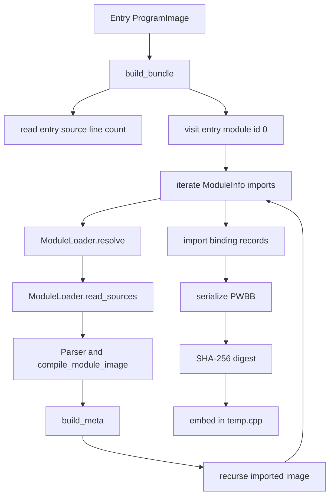
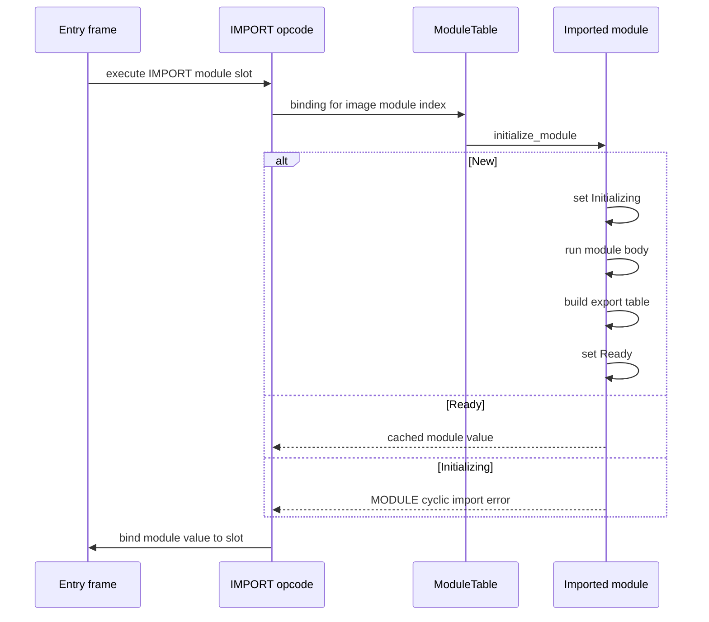
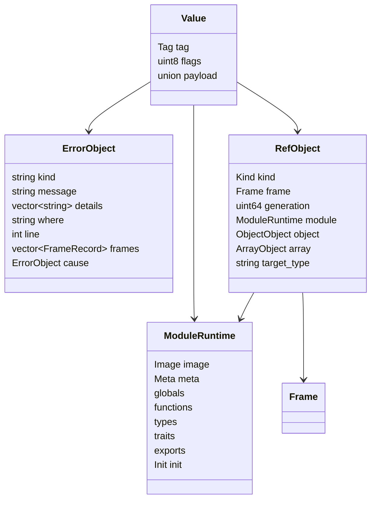

# N4: Native Modules, Errors and References Implementation Plan

Status: planned only. No N4 feature is implemented by this document. N0, N1, N2 and the N3 core are implemented and committed. The N3 lock and error remainder is still open. N4 is the next native milestone.

Reference engine: the Python bytecode VM in `src/vm`, package version `0.22.0`, image format `PWB1` version `1`, metadata block `PWBM` version `1`.

Purpose: define an implementation-ready path for the native runtime to support modules, imports, wildcard imports, exports, module member access, the module cache, project values, externs, language errors, `try`, `catch`, `finally`, propagation, error frames, error text and stream parity, and references.

The Python VM remains the default engine and the differential oracle. The tree walker remains the language reference and the fallback with `--engine=tree`. A native difference is a native bug unless the Python VM and the tree walker also differ, in which case the native VM matches the Python VM.

Related documents:

1. `docs/phase-4b-bytecode-vm/implementation/N0-native-cpp17-build-plan.md`, section 4.5 and section 2.10.
2. `docs/phase-4b-bytecode-vm/implementation/V6-modules-project-and-packages.md`.
3. `docs/phase-4b-bytecode-vm/implementation/V7-errors-and-references.md`.
4. `docs/phase-4b-bytecode-vm/implementation/STATUS.md`.

## 1. Objective and scope

### 1.1 Objective

N4 gives the native VM the same observable behavior as the Python VM for:

1. Multi-module programs compiled ahead of time into one deterministic bundle.
2. Module initialization order, the module cache, aliases, wildcard imports and exports.
3. Module values and module member access for functions, overload sets, types, values and nested modules.
4. Language errors as catchable values, with `try`, `catch`, `finally`, `throw`, `rethrow`, postfix `?` propagation, error frames and the frame list.
5. Byte-identical error text, stream placement and exit codes for the N4 error corpus.
6. References created by `&`, reference parameters, reference reads and writes, reference pipelines, reference copy rules and reference lifetime checks.
7. Project values from a build-time project snapshot.
8. The extern declaration and call boundary, limited in N4 to scalar and string values with an explicit unsupported boundary for the rest.

The native runtime consumes only the entry `PWB1` image plus every imported module image compiled by the Python compiler. It never compiles source, never parses AST JSON, and never evaluates Python code at run time.

### 1.2 In scope

1. The `PWBB` bundle container, its Python builder and its native parser.
2. A module runtime per bundle record, with its own globals, functions, declared globals, types, traits, exports, wildcard bindings, aliases and initialization state.
3. `IMPORT`, `IMPORT_WILDCARD`, `LOAD_MODULE_MEMBER`, `EXPORT`, `LOAD_PROJECT`, `DECLARE_EXTERN` and `CALL_EXTERN`.
4. `Tag::Module`, `Tag::Error`, `Tag::Ref` and `Tag::Project`, with their heap objects and value operations.
5. `MAKE_ERROR`, `ERROR_PROPERTY`, `THROW`, `PROPAGATE`, `RETHROW`, `TRY_BEGIN`, `TRY_END`, `FINALLY_END`, `SET_RETURN`, `SET_TRANSFER`, `JUMP_IF_TRANSFER`, `APPLY_TRANSFER` and `ABANDON_FINALLY`.
6. `REF_LOCAL`, `REF_GLOBAL`, `REF_FIELD`, `REF_INDEX`, `LOAD_REF` and `STORE_REF`, with reference parameter binding, reference copy and reference lifetime.
7. The exception entry table lookup, the frame handler stack, the unwinder, frame records and error text rendering.
8. The bundle project snapshot and the native `Project` value.
9. The build-time extern descriptor table and the host extern boundary for scalar and string values.
10. A corpus and unit test plan that keeps the Python VM as the differential oracle.

### 1.3 Out of scope

1. A native parser, type checker or source compiler.
2. Async tasks, worker tasks, `AWAIT`, `SPAWN`, cancellation, file I/O and task native methods. These remain N5.
3. General Python extern execution. N4 defines the ABI and the table, but only scalar and string externs are supported. File, task and handle externs remain N5.
4. Full byte-identical error text for every existing N1 to N3 `runtime_fail` site. N4 converts the sites exercised by the N4 error corpus and establishes the error API. The remaining N3 lock, access-control and ambiguity text parity is the N3 remainder.
5. A tracing garbage collector. The arena remains the allocation policy in N4.
6. Package download or runtime package resolution. The bundle is built from the already resolved project and module graph.
7. A native debug adapter.

### 1.4 Milestone boundaries

| Area | N3 remainder | N4 | N5 |
|---|---|---|---|
| Types and traits | Core is implemented. Exact access-control, ambiguity and lock error text remains. | Imported types and imported traits, module-qualified construction and static calls. | No change. |
| Native method locks | Native method lock enforcement remains. | `SET_LOCKS` and object lock storage already exist. N4 does not add native method lock coverage. | No change. |
| Modules | None. | Bundle, module runtime, imports, exports, wildcards, project and externs. | Task-local module scope cloning. |
| Errors | Error text conversion for access-control, ambiguity and locks remains. | Error values, unwinder, try, catch, finally, propagation, frames and stream parity. | Task error storage and awaited errors. |
| References | None. | Ref values, all reference opcodes, reference parameters, copy and lifetime. | Reference interaction with worker tasks is not claimed. |
| Files and tasks | None. | None beyond the extern boundary. | File and task builtins, task native methods, worker pool. |

The N4 gate does not close the N3 remainder. It provides the `ErrorObject` API that the N3 remainder will use. The N3 remainder is tracked separately so that N4 can land without silently claiming native method lock coverage.

### 1.5 Success definition

N4 is gate green only when:

1. The N4 corpus reports zero mismatches against the Python VM for standard output, standard error and exit code.
2. Every N4 error case produces byte-identical error text, including `ln: N | `, the `[KIND ERROR]` header, details and frames.
3. A multi-module fixture with a relative import, an aliased import, a wildcard import, an exported function, an exported variable and an exported type matches the Python VM.
4. A module imported twice executes its top-level code once and returns the same module value.
5. A module import cycle is detected and produces the Python module error shape at the import point.
6. Reference parameters, reference pipelines, field references and array element references match the Python VM.
7. A reference to a constant is rejected with the Python reference error text.
8. The full Python test suite remains green.
9. The existing N1, N2 and N3 native corpora remain green.

## 2. The multi-module bundle

### 2.1 Current limitation

The integrated build embeds one entry `PWB1` image plus one `PWBM` block. `run_embedded_image_with_meta(image, image_size, meta, meta_size, host)` parses that image and runs its entry code. The native runtime has one `Module` struct inside `vm.cpp`, and `Machine` holds one `Module`. The Python VM, by contrast, loads imported modules at run time through `get_module_loader()`. The `IMPORT` opcode calls `loader.load(descriptor)`, which parses, compiles and executes the imported module. The native runtime has no Python compiler and no parser, so the imported module images must be produced at build time and carried with the entry image.

The current `ModuleInfo.imports` entries are JSON strings in the image. Native code stores them as raw text and cannot decode them. The bundle must therefore carry resolved import bindings, not just raw image bytes.

### 2.2 Decision

N4 adds a deterministic `PWBB` container. It contains:

1. The entry module identity and the entry source path.
2. Every reachable module image compiled by the existing Python compiler.
3. The matching `PWBM` metadata block for each module image.
4. A per-module import binding table resolved at build time.
5. A per-module export table copied from `ModuleInfo.exports`.
6. An optional project snapshot.
7. A SHA-256 digest of the whole bundle.

The nested `PWB1` and `PWBM` blocks stay byte-for-byte unchanged. The bundle is a container, never a second image format and never a second source of truth.

The raw `pwb_native run image.pwb` path keeps the current single-image behavior. The generated `temp.cpp` for the integrated build embeds a bundle and calls `run_embedded_bundle_with_meta`. Both paths remain available so that N0 to N3 tests and the raw runtime tool keep working.

### 2.3 `PWBB` layout

All integers are little endian. Strings are a `u32` byte length followed by UTF-8 bytes. The digest is the last field and covers every byte before it.

```text
offset  size  field
0       4     magic "PWBB"
4       2     format version, currently 1
6       2     flags, bit 0 project present
8       4     entry module id
12      4     module count
16      ...   entry path string
...     4     entry source line count
...     ...   project block, present when flags bit 0 is set
...     ...   module records, in module id order
...     32    SHA-256 of every byte before this field
```

Project block:

```text
u32 module name count
  repeated string
u32 path count
  repeated string
string log level
u8 allow system
u8 reserved[3]
string engine
```

Module record:

```text
u32 module id, must equal the record index
u32 image module index, the entry module index inside this image
u8  status, 0 image, 1 deferred import error
u8  bind project, 1 when the module should receive the built-in project
u8  reserved[2]
string name
string path
string identity
if status == 0:
  u32 image length
  bytes image
  u32 metadata length
  bytes metadata
  u32 import binding count
    u32 image module index, the pseudo module index used by IMPORT
    u32 target module id
    u8  flags, bit 0 wildcard, bit 1 explicit alias
    u8  reserved[3]
    string alias
  u32 export count
    string export name
    u8 kind, 0 variable, 1 function, 2 type
if status == 1:
  string error kind
  string error message
  string error base text
```

Rules:

1. `module id` is assigned in depth-first discovery order. The entry module is always id 0.
2. `image module index` is `image.entry_module` for the module image. For import binding records it is the index of the pseudo `ModuleInfo` created by `compile_use`, which is the index used by the `IMPORT`, `IMPORT_WILDCARD` and `LOAD_MODULE_MEMBER` operands.
3. `identity` is the resolved path string from the Python module loader. It is the deduplication and cache key. The native runtime never re-resolves it.
4. The entry `PWB1` bytes and `PWBM` bytes are exactly `image.to_bytes()` and `build_meta(image)`. The bundle never rewrites them.
5. The header `entry source line count` is the value Python uses for the entry source `source.count('\n') + 1`. The native top-level error path uses it to reproduce the `ln: N | ` prefix that `run_program` adds when a top-level error has no line.
6. A module with `status == 1` has no image. It exists so that a missing module or an unresolved import can raise at the `IMPORT` point, after any output produced before the import, instead of failing the whole build before the program starts.
7. An import cycle is not a build failure. The builder stops recursion at the repeated identity and emits the already allocated module id. The native runtime raises the cycle error from the initialization-in-progress guard. This preserves Python output order.

### 2.4 Python bundle builder

Create `src/vm/native/bundle.py`.

```python
from __future__ import annotations

from dataclasses import dataclass
from pathlib import Path
from typing import Any

from ..image import ProgramImage

BUNDLE_MAGIC = b"PWBB"
BUNDLE_VERSION = 1
BUNDLE_FLAG_PROJECT = 1 << 0


@dataclass(frozen=True)
class BundleImport:
    image_module_index: int
    target_module_id: int
    alias: str
    wildcard: bool
    explicit_alias: bool


@dataclass(frozen=True)
class BundleModule:
    module_id: int
    name: str
    path: str
    identity: str
    image_module_index: int
    bind_project: bool
    status: int
    image: bytes
    meta: bytes
    imports: tuple[BundleImport, ...]
    exports: tuple[tuple[str, str], ...]
    error_kind: str = ""
    error_message: str = ""
    error_text: str = ""


@dataclass(frozen=True)
class BundleProject:
    modules: tuple[str, ...]
    paths: tuple[str, ...]
    log_level: str
    allow_system: bool
    engine: str


@dataclass(frozen=True)
class Bundle:
    entry_module: int
    entry_path: str
    entry_source_line_count: int
    modules: tuple[BundleModule, ...]
    project: BundleProject | None
    digest: bytes

    def to_bytes(self) -> bytes:
        """Serialize this bundle deterministically."""


def build_bundle(image: ProgramImage, state: Any) -> bytes:
    """Build the PWBB payload for one entry image and its module graph."""


def build_bundle_from_image(image: ProgramImage, state: Any) -> Bundle:
    """Build the structured bundle used by tests and diagnostics."""


def parse_bundle(data: bytes) -> Bundle:
    """Parse a PWBB payload for tests and diagnostics."""
```

`build_bundle` returns `to_bytes()`. `build_bundle_from_image` is the implementation and the test seam. `parse_bundle` is a Python mirror of the native parser used by `tests/test_native_bundle.py` and by the build summary. It is not used at native run time.

Builder algorithm:

1. Use `loader = get_module_loader()`. The active state must already be the state passed to `build_bundle`.
2. Read the entry module path from `image.module_info(image.entry_module).path`. If the path exists, call `loader.read_sources(Path(path))` to get the entry source line count. If it does not exist, use line count 0.
3. Start DFS at the entry image with module id 0. Keep `ids: dict[str, int]` keyed by resolved identity and `visiting: list[str]`.
4. For each module image, iterate `enumerate(image.modules)`. Every entry whose imports is non-empty is either the real entry module or a pseudo module created by `compile_use`. Process all of them. The real entry binding is redundant for the current compiler but harmless, and it covers a future `LOAD_MODULE_MEMBER` that targets the real entry module index. For each descriptor in `module_info.imports`, take `imports[0]`:
   - `kind = descriptor.get("kind", "name")`
   - `name = descriptor.get("name", "")`
   - `base = descriptor.get("base") or module_info.path`
   - `level = descriptor.get("level", 0)`
   - `target_path = loader.resolve(kind, name, Path(base), level)`
   - The alias is `descriptor.get("alias") or Path(name).stem`.
   - The wildcard flag is `bool(descriptor.get("wildcard"))`.
   - The explicit alias flag is `descriptor.get("alias") is not None`.
5. Resolve each target path to `identity = str(target_path.resolve())`. If the identity is already in `ids`, reuse the module id and add the binding. If it is in `visiting`, reuse the module id and stop recursion. This is the cycle edge.
6. On the first visit, allocate the module id before recursing. Compile the imported module from its sources:
   - `sources = loader.read_sources(target_path)`
   - parse every source with `Parser(text, source_path=source_path)` in the loader's sorted order
   - call `compile_module_image(ast, sources.name, target_path, state)`
   - call `build_meta(imported_image)`
   - recurse over the imported image.
   The builder uses the existing parser, compiler, verifier and metadata generator. It does not evaluate the module and does not call `loader.load`.
7. If `loader.read_sources` raises `PowangError` for a missing module or a read failure, append a `BundleModule` with `status = 1`, `error_kind = error.kind`, `error_message = error.message`, `error_text = error._base_text`, and continue. The import binding points at that error record.
   - A parser error in an imported module is converted with `powang_error_from_exception` and wrapped exactly as `ModuleLoader._wrap` does, including the `ln: <row + 1> | <error>` detail. It becomes a status 1 record.
   - A compiler or verifier failure in an imported module also becomes a status 1 record with a `MODULE` wrapper around the error text. It is not allowed to abort the whole bundle build before the program runs.
   - The entry module is already compiled by the caller. A parse or compile failure in the entry module is reported by the existing CLI before `build_bundle` runs.
8. Record `bind_project` per module by scanning the top-level AST for a `project` declaration, using the same rule as `src.vm.modules._has_project_declaration`. A module that declares `project` must not receive the built-in binding.
9. Build the project block from `state.project_value` when it exists. Read the values from `state.project_value.data`, which is the same public property map the Python VM exposes. The fields are `modules`, `paths`, `logLevel`, `allowSystem` and `engine`. Read `state.allowed_extern_modules` for the build-time extern allowlist.
10. Serialize modules in module id order and append the SHA-256 digest of every preceding byte.

Determinism rules:

1. Directory module sources are read in the sorted order already used by `ModuleLoader._evaluate`.
2. Import order follows `image.modules` order, which follows source order.
3. Module ids follow first-visit DFS order, entry first.
4. No timestamps, no absolute temporary paths, no process identifiers and no unordered map iteration are used in the serialized bytes.
5. `build_meta` is deterministic for a given image.
6. A test builds the same graph twice and asserts identical bytes and identical digest.

### 2.5 Module loader integration

Do not reimplement module resolution. `src/module_loader.py` gains one additive method that extracts the source collection already inside `_evaluate`:

```python
@dataclass(frozen=True)
class ModuleSources:
    name: str
    path: Path
    sources: tuple[tuple[Path, str], ...]


class ModuleLoader:
    def read_sources(self, path: Path) -> ModuleSources:
        """Return the module name and ordered source texts without evaluating."""
```

`_evaluate` calls `read_sources` and keeps its current error wrapping. The bundle builder calls `read_sources` and compiles the returned sources with `compile_module_image`. No resolver logic is duplicated. The loader cache is not populated by the builder, because the builder never executes the module.

The builder uses `get_module_loader()` exactly as the brief requires. Tests that call `build_bundle` must install the state with `set_state(state)` first.

### 2.6 Native bundle parser and module table

Create `native/include/pwb/bundle.hpp` and `native/src/bundle.cpp`. Add `native/include/pwb/sha256.hpp` and `native/src/sha256.cpp`.

```cpp
// native/include/pwb/bundle.hpp
#pragma once

#include <array>
#include <cstddef>
#include <cstdint>
#include <optional>
#include <string>
#include <utility>
#include <vector>

#include "pwb/image.hpp"
#include "pwb/meta.hpp"

namespace pwb {

struct BundleImport {
    std::uint32_t image_module_index = 0;
    std::uint32_t target_module_id = 0;
    std::string alias;
    bool wildcard = false;
    bool explicit_alias = false;
};

struct BundleModule {
    std::uint32_t module_id = 0;
    std::string name;
    std::string path;
    std::string identity;
    std::uint32_t image_module_index = 0;
    bool bind_project = false;
    std::uint8_t status = 0;
    std::vector<std::uint8_t> image_bytes;
    std::vector<std::uint8_t> meta_bytes;
    std::vector<BundleImport> imports;
    std::vector<std::pair<std::string, std::string>> exports;
    std::string error_kind;
    std::string error_message;
    std::string error_text;
    Image image;
    Meta meta;
    bool has_meta = false;
};

struct BundleProject {
    std::vector<std::string> modules;
    std::vector<std::string> paths;
    std::string log_level = "info";
    bool allow_system = false;
    std::string engine = "tree";
};

struct Bundle {
    std::uint16_t version = 0;
    std::uint16_t flags = 0;
    std::uint32_t entry_module = 0;
    std::string entry_path;
    std::uint32_t entry_source_line_count = 0;
    std::vector<BundleModule> modules;
    std::optional<BundleProject> project;
    std::array<std::uint8_t, 32> digest{};

    const BundleModule& module(std::uint32_t id) const;
};

Bundle parse_bundle(const std::uint8_t* data, std::size_t size);

std::array<std::uint8_t, 32> sha256(
    const std::uint8_t* data, std::size_t size);

std::string format_bundle_summary(const Bundle& bundle);

} // namespace pwb
```

Parser rules:

1. Reject a total size above 256 MiB, a module count above 4096 and any string or byte length beyond the remaining bytes.
2. Reject a bad magic, a version other than 1, an entry module id outside the module list, a module id that does not equal its index, and an import target outside the module list.
3. Recompute SHA-256 over the first `size - 32` bytes and compare with the trailing digest.
4. For status 0 records, call `parse_image` on the embedded bytes, `parse_meta` on the embedded metadata and `validate_meta`. Compare `meta.image_hash` with `sha256(image_bytes)` explicitly, because the current `validate_meta` does not perform that comparison. Add the same comparison to `run_embedded_image_with_meta` for the single-image path. A metadata block is required for every image that declares functions. A missing block is accepted only for an image with no functions.
5. For status 1 records, keep the error kind, message and base text and do not parse an image.
6. Reject duplicate identities. The bundle builder guarantees uniqueness, and the parser enforces it.
7. A parse failure throws `BundleError`, declared in `native/include/pwb/error.hpp`. `run_embedded_bundle_with_meta` writes `native bundle error: ...` to standard error and returns 1.

The native runtime keeps a `ModuleTable`. This table is the module cache. It is keyed by module id and by resolved path identity.

```cpp
class ModuleTable {
public:
    ModuleTable(Bundle& bundle, Arena& arena);
    ModuleRuntime& get(std::uint32_t module_id);
    ModuleRuntime* find_by_identity(const std::string& identity);
    ModuleRuntime& entry();
    std::size_t size() const;

private:
    std::vector<std::unique_ptr<ModuleRuntime>> modules_;
    std::unordered_map<std::string, ModuleRuntime*> by_identity_;
};
```

`Bundle` lives for the whole VM session. Each `ModuleRuntime` points at its `BundleModule`, which owns the parsed `Image` and `Meta`. The vector of bundle modules is fully parsed before the module table is built, so pointers stay stable.

### 2.7 Source generation and loader integration

Modify `src/vm/native/source_gen.py`:

```python
@dataclass(frozen=True)
class SourceOptions:
    entry_label: str = "program"
    emit_crc: bool = True
    emit_meta: bool = True
    embed_bundle: bool = False


def render_bundle_cpp(
    bundle: bytes, options: SourceOptions | None = None) -> str: ...


def render_bundle_cpp_buffer(
    bundle: bytes, options: SourceOptions | None = None) -> io.StringIO: ...


def render_bundle_cpp_into(
    buffer: io.StringIO,
    bundle: bytes,
    options: SourceOptions | None = None,
) -> None: ...
```

The generated source for a bundle contains:

1. The `kPwbBundle` byte array.
2. `constexpr std::size_t kPwbBundleSize = sizeof(kPwbBundle);`.
3. A `main` that creates `pwb::StdoutHost host` and returns `pwb::run_embedded_bundle_with_meta(kPwbBundle, kPwbBundleSize, host)`.
4. No separate image or metadata arrays when `embed_bundle` is true.

`render_temp_cpp`, `render_temp_cpp_buffer` and `render_temp_cpp_into` keep their current signatures and single-image output. This is the compatibility path for `pwb_native run`, the N0 gate and the existing tests.

Modify `src/vm/native/loader.py`:

```python
def compile_image(
    image: ProgramImage,
    *,
    output: Path | None = None,
    keep_source: bool = False,
    paths: RuntimePaths | None = None,
    state: Any | None = None,
    bundle: bytes | None = None,
) -> NativeProgram: ...


def run_native(
    image: ProgramImage,
    args: Sequence[str] = (),
    *,
    input_text: str | None = None,
    timeout: float = 60.0,
    paths: RuntimePaths | None = None,
    state: Any | None = None,
    bundle: bytes | None = None,
) -> NativeRunResult: ...
```

Behavior:

1. If `bundle` is provided, render bundle source and compile it.
2. If `state` is provided and `bundle` is None, call `build_bundle(image, state)` after ensuring the state is installed.
3. If neither is provided, keep the single-image path exactly as today. This keeps every existing call site and test unchanged.
4. If `state` is provided but the image has no imports, the builder still emits an entry-only bundle. This is deliberate so the bundle path is exercised by every N4 test, not only by multi-module tests.

Create `src/vm/native/session.py` with the shared file setup and run path:

```python
@dataclass
class NativeFileSession:
    state: Any
    image: ProgramImage
    bundle: bytes
    entry_path: Path


def prepare_state(path: str | Path) -> Any:
    """Create the state used by the native file path."""


def compile_native_file(
    path: str | Path,
    *,
    check: bool = True,
) -> NativeFileSession: ...


def run_native_file(
    path: str | Path,
    args: Sequence[str] = (),
    *,
    input_text: str | None = None,
    timeout: float = 60.0,
) -> NativeRunResult: ...
```

`prepare_state` mirrors the existing `_setup_state` in `src/vm/cli.py`: `fresh_state()`, `state.engine = "vm"`, `load_project_config`, `load_config`, `load_package_config`, `require_packages_ready`, `state.paths["RELATIVE"] = Path(path).resolve()` and `state.paths["ABSOLUTE"] = <powang.py>`. `compile_native_file` installs the state with `set_state(state)`, compiles the entry image, calls `build_bundle`, and closes the state only after the bundle bytes exist. `run_native_file` calls `run_native(image, bundle=bundle)`.

Modify `src/vm/cli.py`:

1. `_native_run` calls `run_native_file(path, script_args)` and keeps writing `result.stdout` and `result.stderr`.
2. `_native_compile` calls `compile_native_file`, then `compile_image(session.image, output=..., bundle=session.bundle)`.
3. A `PowangError` raised while building the bundle is printed to standard output with `print(str(error))` and returns 1. It is not reported as a native build error. This matches the Python CLI for a missing module or a module load failure.

### 2.8 Size, time and validation limits

1. Bundle size limit: 64 MiB by default for the integrated path, 256 MiB hard limit in the native parser.
2. Module count limit: 4096.
3. Per-module image limit: 64 MiB.
4. Per-module metadata limit: 64 MiB.
5. Per-string limit: remaining bytes.
6. The build reports `bundle bytes`, `module count`, `total image bytes` and `total metadata bytes` in `--json` mode for `powang vm native info` or a future `native bundle` command.
7. The generated source remains deterministic. A test builds the same bundle twice and hashes the generated source.

## 3. Module runtime and opcodes

### 3.1 Per-module runtime

Create `native/include/pwb/module.hpp`. Move the current `TraitRuntime` and `Module` out of the anonymous namespace in `vm.cpp` and replace the single `Module` with:

```cpp
struct TraitRuntime {
    const TraitInfo* info = nullptr;
    ModuleRuntime* module = nullptr;
    std::unordered_map<std::string, std::vector<FunctionObject*>> defaults;
};

struct ExportEntry {
    enum class Kind : std::uint8_t { Variable, Function, Type };
    Kind kind = Kind::Variable;
    Value value;
    std::vector<FunctionObject*> functions;
    TypeRuntime* type = nullptr;
};

struct ModuleRuntime {
    enum class Init : std::uint8_t { New, Initializing, Ready, Failed };

    const BundleModule* bundle = nullptr;
    const Image* image = nullptr;
    const Meta* meta = nullptr;
    std::string name;
    std::string path;
    std::string identity;
    std::uint32_t module_id = 0;
    bool bind_project = false;
    bool legacy = false;
    bool warned = false;
    Init init = Init::New;

    std::unordered_map<std::string, Value> globals;
    std::unordered_set<std::string> declared_globals;
    std::unordered_map<std::string, std::vector<FunctionObject*>> functions;
    std::unordered_map<std::string, TypeRuntime> types;
    std::unordered_map<std::string, TraitRuntime> traits;
    std::unordered_map<std::string, ModuleRuntime*> aliases;

    std::unordered_map<std::string, Value> wildcard_values;
    std::unordered_map<std::string, std::vector<FunctionObject*>> wildcard_functions;
    std::unordered_map<std::string, TypeRuntime*> wildcard_types;
    std::unordered_map<std::string, std::string> wildcard_sources;

    std::unordered_map<std::string, ExportEntry> exports;
};
```

The module runtime owns its symbol tables. It does not own the image or metadata, which stay in the bundle record.

`ModuleRuntime` has no separate language module object. `Tag::Module` carries a `ModuleRuntime*`. The module value is immutable because no store opcode writes to a module.

### 3.2 Object and function identity

`FunctionObject` gains a module pointer. `ObjectObject` gains a type pointer and a module pointer. `TypeRuntime` gains a module pointer and a qualified name.

```cpp
struct FunctionObject {
    const FunctionMetadata* metadata = nullptr;
    ModuleRuntime* module = nullptr;
    std::vector<Value> captures;
    CapturedScope captured;
    Value receiver = make_nova();
    bool has_receiver = false;
    TypeRuntime* owner = nullptr;
    bool is_static = false;
    bool is_private = false;
    std::string trait_qualifier;
};

struct ObjectObject {
    TypeRuntime* type = nullptr;
    ModuleRuntime* module = nullptr;
    std::string type_name;      // diagnostic mirror of type->info->name
    std::string variant;
    bool is_enum = false;
    bool structure_locked = false;
    bool elements_locked = false;
    std::unordered_map<std::string, Value> fields;
    std::unordered_set<std::string> private_fields;
};

struct TypeRuntime {
    const TypeInfo* info = nullptr;
    ModuleRuntime* module = nullptr;
    std::string qualified_name; // module.name + "." + info->name
    std::unordered_map<std::string, std::vector<FunctionObject*>> methods;
    std::unordered_map<std::string, std::vector<FunctionObject*>> statics;
    std::unordered_map<std::string, std::vector<FunctionObject*>> constructors;
    std::unordered_map<
        std::string,
        std::unordered_map<std::string, std::vector<FunctionObject*>>>
        trait_methods;
};
```

Rules:

1. `DECLARE_FUNCTION` sets `function->module = &frame.module`.
2. `DECLARE_TYPE` sets each `TypeRuntime.module = &frame.module` and `qualified_name`.
3. Every method and static function allocated for a type inherits the type's module.
4. A bound method copy copies `module`, `owner`, `is_static`, `is_private` and `trait_qualifier`, then sets the receiver.
5. `call_function` uses `function->module->image` and `function->module->meta`, never a machine-global current image.
6. `runtime_type_name` returns `object->type->info->name` when the type pointer is set, and falls back to `type_name` only for legacy values.
7. Object equality, copy and formatting use the type pointer and the variant.

The object type pointer is the fix for imported types. A name-only lookup in `machine.module.types` cannot find a type declared in another module.

### 3.3 Module table, initialization and module values

`Machine` replaces its single `Module module` with a `ModuleTable` and a current module stack:

```cpp
struct Machine {
    Host& host;
    Arena arena;
    const Bundle* bundle = nullptr;
    ModuleTable modules;
    std::vector<ModuleRuntime*> module_stack;
    std::size_t frame_depth = 0;
    std::size_t max_frames = 256;
    std::vector<CallFrameRecord> call_frames;
};
```

`ModuleTable` constructs one `ModuleRuntime` per bundle record. Status 0 records get parsed image and metadata. Status 1 records get a deferred error. The entry module is `modules.get(bundle.entry_module)`.

`make_module(ModuleRuntime*)` creates a `Tag::Module` value.

Initialization function:

```cpp
void initialize_module(ModuleRuntime& module, Machine& machine);
```

Behavior:

1. `Ready`: return immediately.
2. `Initializing`: raise a `MODULE` error with message `Cyclic module import` and details listing the active chain from the module stack, starting at the first occurrence and ending with the repeated module path. This matches `ModuleLoader._make_error` with `_make_error(path, "Cyclic module import", chain)`.
3. `Failed`: reset the module tables and treat it as `New`. Python does not cache a failed module, so a second import evaluates it again.
4. `New`: set `Initializing`, push the module onto `machine.module_stack`, create a module frame from `image->codes[image->entry_code]`, execute it, build the export table, set `Ready`, then pop.
5. A module error record throws the stored deferred error before any top-level code runs.
6. A module body return value is ignored. The module value is the module runtime itself.
7. An imported module body error is wrapped in a `MODULE` error with `where = "module: <path>"`, message `Module failed to load` and detail `str(error)`, unless the error is already a module error. This mirrors `ModuleLoader._wrap`. The entry module is never wrapped. Its top-level error propagates raw so that the top-level renderer can apply the entry line prefix.
8. Before the body runs, if `bind_project` is true and the bundle has a project, bind `module.globals["project"]` to the project value and add `project` to `declared_globals`.
9. The module entry frame has `frame.is_function = false`, so `RETURN` does not copy and no call frame record is pushed.
10. Module local slots are mirrored into `module.globals` on declaration and store. This is required because native function bodies use `LOAD_FREE` and fall back to module globals, while a module body declares its top-level names as local slots. Without this mirror, a function that reads a top-level variable declared earlier fails with `identifier not found`. The N1 corpus does not cover this pattern. N4 adds a regression test.

The mirror helper:

```cpp
void publish_module_local(Frame& frame, std::uint32_t slot, const Value& value);
```

It runs only when `frame.is_module` is true and the slot name is not empty and does not start with `#`. It writes the value into `frame.module->globals[name]`. It is called from `DECLARE_LOCAL`, `DECLARE_TYPED`, `DECLARE_INFER`, `STORE_LOCAL`, `ASSIGN_LOCAL`, `STORE_RAW` (only named slots) and the reference store path for a module local.

`IMPORT` at module top also writes the alias into `module.globals` and `module.aliases` so that functions in the same module can resolve the alias after the module body has finished.

### 3.4 `IMPORT` and `IMPORT_WILDCARD`

`IMPORT` operands are `module` (u32) and `slot` (u16). The module operand indexes the current image's pseudo `ModuleInfo`. The runtime resolves it through the current module's bundle import binding.

```cpp
const BundleImport& binding =
    frame.module->bundle->imports_for(image_module_index);
ModuleRuntime& target = machine.modules.get(binding.target_module_id);
initialize_module(target, machine);
Value module_value = make_module(&target);
```

Alias and collision rules:

1. The alias is `binding.alias`.
2. Read the existing value in `frame.locals[slot]`. If it is defined and is not the same module value, raise `MODULE` error where `use expression`, message `Import collision for '<alias>'`, details:
   - `module '<target name>' cannot be bound`
   - `'<alias>' is already declared in this scope`
3. Store the module value in the local slot, mark it declared, and publish it to the module global and alias table when the frame is a module frame.
4. If the target module is legacy (no exports) and the import did not use an explicit alias, call `import_wildcard` for the target. This matches the Python `module_value.legacy and descriptor.get("alias") is None` rule.
5. A module value is never copied. `copy_value` returns it by identity.

`IMPORT_WILDCARD` operand is `module` (u32). It initializes the target and binds every export into the current module:

1. For each export name:
   - If the name already exists in `globals`, `functions`, `types` or `wildcard_*`, raise `MODULE` error where `use expression`, message `Import collision for '<name>'`, details:
     - `imported from module '<target name>'`
     - `already provided by module '<source>'` when the collision is another wildcard, otherwise `already provided by an existing function declaration`, `an existing variable declaration` or `an existing type declaration`.
   - A function export binds every overload into `wildcard_functions[name]` and records the source module.
   - A type export binds `wildcard_types[name] = type`.
   - A variable export binds `wildcard_values[name] = value`. When the wildcard import runs in a module frame, it also writes `module.globals[name] = value`, because Python's wildcard import adds the name to the current module scope and `REF_GLOBAL` must see it.
2. Wildcard names are consulted by `resolve_name`, `try_resolve_free`, identifier `CALL`, `CALL_STATIC` and `CONSTRUCT` after locals, captures and module globals, and before failing.
3. A wildcard import does not create a module alias and does not touch the operand stack.

### 3.5 `EXPORT` and the export table

The current compiler writes exports into `ModuleInfo.exports` as `(name, kind)` pairs and does not emit `EXPORT`. `EXPORT` remains a runtime no-op that pops its value. The export table is built after the module body from `ModuleInfo.exports`.

`build_export_table(ModuleRuntime& module)` rules:

1. If `module.image->modules[module.bundle->image_module_index].exports` is empty, the module is legacy. Emit the Python warning to standard error once per resolved path:
   `[MODULE WARNING] module '<name>' declares no exports; exporting all top-level names`
   Then export every top-level variable, function and type.
2. Otherwise iterate the declared exports in order.
3. Duplicate names are allowed only when both entries have kind `function`. Any other duplicate raises `MODULE` error where `module: <path>`, message `Duplicate export: <name>`, details:
   - `already exported as <previous kind>`
   - `then exported again as <kind>`
4. A missing export raises `MODULE` error where `module: <path>`, message `Exported name was not declared: <name>`.
5. Function exports store the overload vector from `module.functions[name]`.
6. Type exports store `&module.types[name]`.
7. Variable exports store `module.globals[name]`.
8. `legacy` is set on the module runtime for the warning and for the `IMPORT` legacy wildcard rule.

`ModuleInfo.exports` kind strings are exactly `function`, `type` and `variable`. The bundle records the same strings and the native export table maps them to `ExportEntry::Kind`.

### 3.6 `LOAD_MODULE_MEMBER` and module member values

`LOAD_MODULE_MEMBER` operands are `module` (u32) and `export` (u32).

Resolution:

1. Resolve the bundle import binding for the current image module index.
2. Determine the member name:
   - If `export` is within the pseudo `ModuleInfo.exports`, use that name.
   - Otherwise use `image.global_names[export]`, matching the Python fallback.
3. Call `module_member_value(target, name, where)`.

`module_member_value` rules:

1. Missing export: `IDENTIFIER` error where `access expression`, message `doens't exists`, details `[name, "module '<name>' has no exported member '<name>'"]`. The typo in `doens't exists` is part of the Python text and must be preserved.
2. Function export with one overload: return a `Tag::Fun` value for that function.
3. Function export with multiple overloads: return a `Tag::Arr` value whose items are the function values, matching `moduleMemberValue` returning `PowangArray(list(member))`.
4. Type export: return a `Tag::Type` value for the `TypeRuntime`.
5. Variable export: return the stored value. If the stored value is a function, it behaves as a function value.
6. A module export that holds a module returns the module value.

`LOAD_MEMBER` on `Tag::Module` calls the same `module_member_value` path with where `access expression`. `STORE_MEMBER` on `Tag::Module` raises `MODULE` error with message `Modules are immutable` and detail `cannot assign to '<module>.<name>'`.

### 3.7 `CALL_MODULE`, `CALL_METHOD` and bound functions

`CALL_MODULE` is not implemented today. Add it to the call handler.

Stack order:

1. Arguments are pushed in source order.
2. The module target is pushed after the arguments.
3. `ROT` rotates the module target below the arguments.
4. `CALL_MODULE` pops the argument values first, then the module target.

Rules:

1. The target must be `Tag::Module`. Otherwise fall back to a value call exactly as `dispatch.call_module` does.
2. Named arguments are rejected with `ARGUMENT` error where `module: <name>`, message `Named arguments are not supported for module members`.
3. Look up the export. For a function export, select the overload with the target module's `Meta`. For a non-function callable value, call the value. Otherwise raise the identifier error for the member.
4. `CALL_METHOD` with a `Tag::Module` receiver delegates to the same module member call. This matches `dispatch.call_method`, which checks `PowangModule.type` before user object dispatch.
5. `CALL_METHOD` with a `Tag::Type` receiver is a static call through the type runtime.
6. Bound method creation copies `module`, `owner`, `is_static`, `is_private`, `trait_qualifier`, `receiver` and `has_receiver`. The bound function's module is the owner type's module, not the caller's module.

### 3.8 Name resolution and wildcard scope

Native name resolution remains slot based. N4 extends the fallback chain:

1. Local slot by name.
2. Captured reference, value or function.
3. Current module global.
4. Current module function table.
5. Current module wildcard values, functions and types.
6. Module aliases, returning the module value.

`LOAD_LOCAL` and `LOAD_RAW` differ only in reference unwrapping. `LOAD_LOCAL`, `LOAD_GLOBAL`, `LOAD_NAME` and `LOAD_FREE` unwrap `Tag::Ref` by reading through it. `LOAD_RAW` returns the reference value itself.

`LOAD_FREE` inside a function from an imported module uses `frame.module->globals` and `frame.function->module`, never the caller's module. This is the key multi-module closure rule.

`assign_name` and `STORE_GLOBAL` write to the module that owns the frame, not the machine's entry module. `STORE_GLOBAL` on an imported module value is impossible because modules are immutable.

### 3.9 Imported types, traits and constructors

Type names in call sites can be qualified, for example `g.Point`. `compile_instantiation` stores the full name in `site.type_name` and `site.name`, and the type index falls back to 0 when the type is not declared in the current image.

Resolution order for `CONSTRUCT` and `CALL_STATIC`:

1. If the name contains a dot, split at the first dot into `qualifier` and `member`.
   - Resolve `qualifier` in the current frame locals, then the module alias table.
   - The result must be `Tag::Module`, otherwise raise `IDENTIFIER` error.
   - Look up `member` in the target module's types.
2. If the name has no dot, look in the current module's types.
3. Then look in the wildcard type table.
4. Otherwise raise `IDENTIFIER` error with where `instantiation` or `method call`.

`NEW_ENUM` uses `frame.module->types[info.name]`, not a machine-global type table. The resulting object points at that `TypeRuntime`.

`LOAD_MEMBER` on a `Tag::Type` value resolves a static method by name and returns a static bound function. For an enum type it returns the variant object. This keeps `g.Point.make()` and `g.Color.Red` on the same member path as a local type.

`CALL_TRAIT`, `CHECK_TRAIT` and `TRAIT_CAST` resolve traits through the object's type module and the current module's wildcard traits. A trait object runtime carries its module pointer so default methods resolve in the defining module.

`object_satisfies_trait` uses `object->type`, its info properties and its method tables. It never looks up a type by name in the current module.

### 3.10 Module entry execution and cycles

1. The entry module runs once, before any other module.
2. An imported module runs when its first `IMPORT` or `IMPORT_WILDCARD` executes.
3. A module imported twice under different aliases runs once and returns the same module value.
4. A module imported after it is `Ready` returns the cached value.
5. A repeated import while the module is `Initializing` raises the cycle error with the active chain.
6. A module body error propagates out of the `IMPORT` instruction and can be caught by an enclosing `try` in the importer. The module is reset to `New` so a later import retries it, matching the Python loader, which does not cache a failed module.
7. A module whose bundle record is a deferred import error raises that error at the import point, after any earlier output.
8. Module top-level code executes with the module runtime's own image, metadata and globals. It never uses the entry image.

### 3.11 Machine and frame refactor checklist

Every current use of `machine.module` or `machine.image` must be reviewed. The replacement rules are:

| Current use | Replacement |
|---|---|
| `machine.module.globals` | `frame.module->globals` |
| `machine.module.functions` | `frame.module->functions` |
| `machine.module.types` | `frame.module->types` |
| `machine.module.traits` | `frame.module->traits` |
| `machine.module.declared_globals` | `frame.module->declared_globals` |
| `machine.image->codes` | `frame.module->image->codes` |
| `machine.image->types` | `frame.module->image->types` |
| `machine.image->global_names` | `frame.module->image->global_names` |
| `machine.meta` | `function->module->meta` or `frame.module->meta` |
| `machine.image` in `call_function` | `function->module->image` |

`make_frame` becomes:

```cpp
Frame make_frame(
    const CodeObject& code,
    ModuleRuntime& module,
    FunctionObject* function,
    bool is_function);
```

The function sets `frame.module`, `frame.function`, `frame.is_function` and the local slot name map.

`execute` becomes `Value execute(Frame& frame, Machine& machine)`. It reads `const Image& image = *frame.module->image` at entry. `load_constant`, `global_name_at` and `select_overload` take the module or the image explicitly.

The refactor is mechanical but broad. It lands in N4.1 before any new N4 opcode, and the N1, N2 and N3 corpora must stay green after every sub-step.

## 4. The error model

### 4.1 `Tag::Error` and `ErrorObject`

Add `Tag::Error`. A language error is a value.

```cpp
struct FrameRecord {
    std::string name;
    std::string file;
    std::int32_t line = 0;
    std::int32_t column = 0;
    std::string render() const;
};

struct ErrorObject {
    std::string kind = "ERROR";
    std::string message;
    std::vector<std::string> details;
    std::string where;
    std::int32_t line = 0;
    std::int32_t column = 0;
    std::vector<FrameRecord> frames;
    ErrorObject* cause = nullptr;
    std::string text_override;   // deferred bundle errors only
    bool has_text_override = false;

    std::string base_text() const;
    std::string text() const;
    std::string readable() const;
};
```

Rules:

1. `kind` is the exact uppercase kind string. `ERROR` is the generic kind and renders as `[ERROR]`.
2. `base_text()` implements `_format_error_text` from `src/error.py` exactly.
3. `text()` prefixes `ln: <line> | ` when `line` is greater than zero.
4. `readable()` implements `PowangErrorValue.from_error`: `[KIND ERROR]` or `[ERROR]`, then a space and the message when the message is non-empty. It does not include `where` or details.
5. `text_override` is used only for a deferred bundle import error that was created by the Python loader. `kind` and `message` are also restored from the bundle record so `readable()` matches Python. `base_text()` returns the override and `text()` applies the line prefix normally.
6. `cause` points to another arena allocated error. It is used by `ERROR_PROPERTY` `cause`.
7. `frames` are attached on the way out and are exposed by `ERROR_PROPERTY` `frames`.
8. `ErrorObject` is arena allocated. It is never copied.

`Tag::Error` value operations:

1. `format_value` prints `readable()`.
2. `truthy` returns true. Python error values are ordinary objects and are truthy.
3. `value_equal` compares identity.
4. `copy_value` returns the same value.

### 4.2 Error text

The exact format is binding:

```text
[KIND ERROR] (in where) message:
      | detail one
      | detail two
```

Rules:

1. When `kind == "ERROR"`, the bracket is `[ERROR]`.
2. When `where` is non-empty, append ` (in <where>)`.
3. When `message` is non-empty, append a space and the message.
4. When details are non-empty, append `:` and then `\n      | <detail>` for each detail.
5. When `line > 0`, prefix `ln: <line> | `.
6. The formatter never adds a trailing newline. The CLI or the test adds exactly one newline when it prints.
7. The N4 error helpers mirror the Python constructors:
   - `error_identifier_not_found(where, name, messages)`
   - `error_type_match(where, expected, encountered)`
   - `error_unsupported_operation(where, left, operator, right)`
   - `error_index_out_of_range(index, size)`
   - `error_key(key)`
   - `error_argument(where, message, details)`
   - `error_module(where, message, details)`
   - `error_reference(where, message, details)`
   - `error_const(where, message, details)`
   - `error_overload(where, message, details)`
   - `error_recursion(where, message, details)`
   - `error_development(where, message, details)`
   - `error_user(where, message, details)`
8. The typo `doens't exists` in `powang_error_identifier_not_found` is preserved.
9. A literal site that currently has a generic `runtime_fail` message is converted only after its exact Python text and `where` string are known. No site is converted by guessing.

### 4.3 Error opcodes

#### `MAKE_ERROR`

Operand `spec` is an inline constant index into the current code object's constants. The constant is a descriptor with `kind == "error_spec"`.

Native needs the descriptor fields `mode`, `where`, `has_kind` and `argument_count`. These come from the PWBM version 2 descriptor table described in section 4.9. The native runtime never parses the descriptor JSON.

Behavior, matching `src/vm/declarations.py:make_error`:

1. Pop exactly `argument_count` values.
2. `required = 2` when `has_kind`, otherwise `1`.
3. Fewer values than `required` raises `ARGUMENT` error where the descriptor `where`, message `not enought arguments`.
4. With `has_kind`: argument 0 must be `str` kind, argument 1 must be `str` message, the rest must be `str` details. A wrong kind raises `TYPE` error where `builtin: fail, kind`, expected `str`. A wrong message raises `TYPE` error where `builtin: fail, message`. A wrong detail raises `TYPE` error where `builtin: fail, argument`.
5. Without `has_kind`: kind is `USER`, argument 0 is the message, the rest are details. A wrong message raises `TYPE` error where `builtin: error, message`.
6. `mode == "value"` returns a `Tag::Error` value.
7. `mode == "raise"` throws the error immediately.
8. Equality of kind strings is exact and case sensitive.

#### `ERROR_PROPERTY`

Operand `property` is a u32 index into the Python property order:

```text
0 kind
1 message
2 details
3 where
4 line
5 column
6 cause
7 frames
```

Behavior:

1. Pop the value. It must be `Tag::Error`, otherwise raise `TYPE` error where `error property`, expected `error`.
2. An out of range property index falls back to `kind`, matching the Python conditional.
3. `kind`, `message`, `where` return strings. `where` returns nova when unset.
4. `details` returns an array of strings.
5. `line` and `column` return int or nova when zero or unset.
6. `cause` returns the cause error value or nova.
7. `frames` returns an array of rendered strings.

`LOAD_MEMBER` on `Tag::Error` calls the same property function with the member name. This is required for `e.kind` and `e.frames`.

#### `THROW` and `RETHROW`

1. `THROW` pops a value. A non-error value raises `TYPE` error where `throw`, expected `error`.
2. `RETHROW` does the same for the value on the stack.
3. Both throw the `ErrorObject` carried by the value.

#### `PROPAGATE`

Postfix `?` behavior from `interpreter.py`:

1. Pop the value. The native N4 subset has no `Any` box, so there is no unwrap step.
2. If it is not an error value, push it and continue.
3. If it is an error value and the frame is not a function, raise `LOGIC` error where `postfix unwrap`, message `Trying to use the '?' operator outside a function scope`, detail `the scope you are trying to unwrap from it's <scope>`.
4. If it is an error value and the frame is a function, walk the handler stack from innermost to outermost, skipping handlers whose state is `finally` and handlers whose `[start_ip, end_ip)` does not contain the current instruction offset.
5. If a matching handler has `finally_ip >= 0`, set the handler state to `finally`, store a copy of the error value in `pending_return`, clear `pending_error`, set `transfer` to `return`, set `ip` to `finally_ip` and continue.
6. If no matching finally exists, return a copy of the error value from the frame. The caller receives a normal error value. This is not an unwind.

#### `TRY_BEGIN`, `TRY_END` and `FINALLY_END`

`TRY_BEGIN`:

1. Find the exception entry whose `start_ip` equals `frame.ip` after the opcode has advanced. Python uses `next_ip = frame.ip`, so the native frame must already point at the next instruction.
2. If no entry exists, throw an internal `RuntimeError` with the same message shape as `VMError(f"TRY_BEGIN at {offset} has no exception entry")`. This is a compiler or image bug, not a language error.
3. Push a handler with:
   - `start_ip`, `end_ip`, `catch_ip`, `finally_ip` and `resume_ip` from the entry
   - `stack_depth = frame.stack.size()`
   - `local_watermark = entry.local_watermark`
   - `scope_depth = 0`
   - `kind` from the entry
   - `state = active`
   - empty `pending_return` and `pending_error`
4. `TRY_END` pops the innermost handler if one exists.
5. `FINALLY_END` pops the innermost handler. If `pending_error` is set, clear it and rethrow it. Otherwise, if a handler was popped, set `frame.ip = handler.resume_ip`.

#### `SET_RETURN`, `SET_TRANSFER`, `JUMP_IF_TRANSFER`, `APPLY_TRANSFER` and `ABANDON_FINALLY`

These five opcodes are ported as one unit.

1. `SET_RETURN` pops a value, copies it, sets `pending_return`, clears `pending_error`, sets `transfer` to `return` and leaves `ip` at the next instruction.
2. `SET_TRANSFER` reads `kind` (0 jump, otherwise return). It sets `transfer` to `jump` with the target or to `return`, clears `pending_error` and `pending_return`.
3. `JUMP_IF_TRANSFER` jumps to its target when `transfer` is set or `pending_return` is set. It does not clear either.
4. `APPLY_TRANSFER`:
   - If both `transfer` and `pending_return` are unset, do nothing.
   - Clear `transfer`.
   - A jump transfer sets `ip` to the target.
   - A return transfer takes `pending_return` or nova, clears `pending_return`, and returns it from the frame. The return value is copied when the frame is a function.
5. `ABANDON_FINALLY` pops the innermost handler when its state is `finally`, then clears `pending_error`, `pending_return` and `transfer`.

### 4.4 Handler stack and unwinder

`Frame` gains:

```cpp
struct Transfer {
    enum class Kind : std::uint8_t { None, Jump, Return };
    Kind kind = Kind::None;
    std::int32_t target = -1;
};

struct HandlerEntry {
    std::int32_t start_ip = 0;
    std::int32_t end_ip = 0;
    std::int32_t catch_ip = -1;
    std::int32_t finally_ip = -1;
    std::int32_t resume_ip = -1;
    std::uint32_t stack_depth = 0;
    std::uint32_t local_watermark = 0;
    std::uint32_t scope_depth = 0;
    std::uint8_t kind = 0;
    std::uint8_t state = 0; // 0 active, 1 catch, 2 finally
    Value pending_return;
    ErrorObject* pending_error = nullptr;
};
```

`Frame` also gains `pending_return`, `pending_error`, `transfer`, `is_module`, `is_function`, `span_index`, `generation` and `alive`.

The private signal is declared in `native/include/pwb/errors.hpp`:

```cpp
struct UnwindSignal {
    ErrorObject* error = nullptr;
};

[[noreturn]] void throw_error(ErrorObject* error);
```

Unwinder contract:

1. `throw_error(ErrorObject*)` throws an internal `UnwindSignal` carrying the error pointer.
2. `execute` wraps the dispatch of one instruction in a `try` block that catches `UnwindSignal`.
3. On catch, `execute` calls `handle_error(frame, signal.error, instruction.offset)`.
4. If `handle_error` returns true, the handler has been activated and the loop continues at the catch or finally instruction.
5. If it returns false, `execute` rethrows the signal, which crosses the nested `call_function` boundary.
6. `call_function`, `call_method` and `call_value` catch `UnwindSignal` only to attach the callee frame record and to decrement the frame depth, then rethrow.
7. The caller's `execute` catches the signal at the call instruction and runs its own `handle_error`. This is how a caller `try` catches a callee error.
8. `run_embedded_bundle_with_meta` catches the top-level `UnwindSignal`, renders the error to standard output and returns 1.
9. `RuntimeError` is not caught by `handle_error`. It represents an internal invariant failure or an unsupported native feature. It reaches the top-level catch, writes `native runtime error: ...` to standard error and returns 1.

This is an implementation amendment to ADR 7 in the N0 plan. Language errors remain values with explicit handler routing. The C++ exception is only a private control transfer between recursive `execute` calls, and it carries a `Tag::Error` value. It never crosses a language `try` boundary without `handle_error` seeing it.

`handle_error` mirrors `interpreter.py:_handle_error` exactly:

1. Walk `frame.handlers` from last to first.
2. Skip handlers whose state is `finally`.
3. Skip handlers whose `start_ip > fault_ip` or `fault_ip >= end_ip`.
4. Restore the block scope watermark if one existed. Native has no block scope name map, so this is a no-op except for recording the watermark.
5. If `catch_ip >= 0` and the handler state is `active`:
   - delete every handler after this index
   - truncate the stack to `handler.stack_depth`
   - set state to `catch`
   - clear `pending_error`, `pending_return` and `transfer`
   - set `ip` to `catch_ip`
   - push the error value
   - return true
6. If `finally_ip >= 0`:
   - delete every handler after this index
   - truncate the stack to `handler.stack_depth`
   - set state to `finally`
   - set `pending_error` to the error
   - clear `pending_return` and `transfer`
   - set `ip` to `finally_ip`
   - return true
7. If the handler cannot route the error, drop it and keep looking outward.
8. If no handler matches, return false.

A finally block that throws replaces the pending error. The new error becomes the active error and the original is attached as `cause` when the language exposes it.

### 4.5 Error frames and the frame list

`CallFrameRecord` is pushed for every function, method, static, constructor and module member call, but never for a module body.

Fields come from the caller's current span:

1. `name` is the frame name passed to the call:
   - identifier call: the function name
   - method call: `<type_name>.<method_name>`
   - static call: `<type_name>.<method_name>`
   - constructor call: `<type_name>.constructor`
   - module member call: the member name
   - value call: the function metadata name or lambda name
2. `file` is the entry source path from the bundle (`entry_path`), matching Python's `state.paths['RELATIVE']` for every module frame.
3. `line` and `column` are the caller's current source span start. A zero line means unknown and the rendered frame omits the line and column.

`FrameRecord::render()` is exactly:

```text
at <name> (<file>:<line>:<column>)
```

When line is zero:

```text
at <name> (<file>)
```

When file is empty:

```text
at <name> (<unknown>)
```

Frames are attached only when the error escapes a function frame, not when it is caught inside that frame. The first escaping call appends the innermost record, the next appends its caller, and so on. This produces the same `reversed(call_frames)` order as `_attach_frames`. An error with a non-empty frame list is never extended again.

`call_function` pushes the record after `bind_function` succeeds and immediately before `execute`. An argument binding failure does not produce a callee record, matching Python, where `bind_parameters` runs before `self.frames.append(frame)`.

`execute` sets `frame.span_index` before dispatch. The decode path stores `span_index` per instruction. Add a `CodeObject::offset_to_index` or `offset_to_span` map built when the image is parsed, so the current instruction can set the span without a linear scan. `TRY_BEGIN` and `PROPAGATE` need the current instruction offset, which is already available.

### 4.6 C++ `RuntimeError` narrowing

`RuntimeError` remains the internal failure type. Its message is not a language diagnostic. It covers:

1. A missing metadata block where one is required.
2. A malformed opcode operand.
3. A stack underflow that the verifier should have rejected.
4. A null pointer or impossible internal state.
5. An unsupported native feature that has no Python language equivalent in N4.

Every existing `runtime_fail` site is classified as one of:

| Class | Action |
|---|---|
| Language error with an exact Python constructor | Replace with the matching `error_*` helper and `throw_error` |
| Language error with context dependent text | Add a helper that takes the exact `where`, message and details from the Python call site |
| Internal invariant | Keep `RuntimeError`, rename the helper to `internal_fail` for readability |
| Unsupported N4 boundary | Raise a language `DEVELOPMENT` error with a clear `unsupported: ...` message, or keep `RuntimeError` when the program cannot observe it |

The N4 error corpus covers the language error families that N4 introduces plus one representative case for identifier, type, argument, index, key, operation, recursion, module, reference, user and throw. The remaining sites are converted in a follow-up N3 remainder task with the same API.

The conversion is not a mechanical string replacement. A site is converted only when a Python test case produces the exact text and `where` for that site.

### 4.7 Stream parity

The Python CLI writes a top-level language diagnostic with `print(str(error))`, which is standard output. The native runtime currently writes every failure to standard error.

N4 behavior:

1. A top-level language error writes `error.text()` plus one newline to `Host::write`, which is standard output.
2. A top-level language error returns exit code 1.
3. A native internal error writes `native runtime error: ...` plus one newline to `Host::write_error`, which is standard error, and returns 1.
4. An image, verifier, metadata or bundle error writes `native image error:`, `native verifier error:`, `native metadata error:` or `native bundle error:` to standard error and returns 1.
5. A caught language error prints nothing by itself. The program decides what to print.
6. `println` and `print` output is unchanged.
7. The native executable keeps binary standard output mode on Windows. The error text is UTF-8.

The N4 differential corpus compares native standard output with Python standard output, including the top-level error text. It compares standard error separately. A language diagnostic appearing on standard error is a gate failure.

Top-level line prefix:

1. When a top-level language error has no line, native sets `line = bundle.entry_source_line_count + 1`. This matches `run_program`, which uses `source.count('\n') + 1`.
2. A module load error wrapper gets the same top-level line, not the inner error's line.
3. A caught error is not given a line by the native runtime. This matches the Python behavior, where `run_program` adds the line only to the final uncaught error.

### 4.8 PWBM version 2 descriptors

`MAKE_ERROR` and `DECLARE_EXTERN` need descriptor data that the native runtime cannot read from AST JSON. Extend `PWBM` to version 2.

New sections, after the function table:

```text
u32 spec map count
  repeated (u32 image type spec index, u32 meta type spec index)
u32 descriptor count
  repeated descriptor record
```

`spec map` is required because the metadata type table deduplicates type specs while maintaining first-seen order, so a metadata index is not always the image type spec index. The N4 `DECLARE_TYPED` const check uses this map.

The implemented PWBM block has no separate block CRC. Its 32-byte image SHA-256 is the integrity check, and the parser rejects trailing bytes. Version 2 keeps that rule and appends the spec map and descriptor sections before the end of the block.

Descriptor record:

```text
u8  descriptor kind, 0 error spec, 1 extern
u32 code index
u32 constant index
if kind == 0:
  string mode
  string where
  u8 has kind
  u32 argument count
if kind == 1:
  string name
  string python target
  u32 min argc
  u32 parameter count
    string type name
    u8 flags, bit 0 reference, bit 1 weak, bit 2 variadic
  string return type
```

Rules:

1. `build_meta` emits version 2 after N4.2 lands. The spec map is needed for const and reference flags even in a program that has no error or extern descriptor, so version 2 is not conditional on descriptors. The parser still accepts version 1 blocks produced before N4.2.
2. The native parser accepts version 1 and version 2. Version 1 has no spec map and no descriptor table. A version 1 block with a const declaration or a reference parameter reports `unsupported: PWBM version 1 spec map` instead of guessing.
3. `validate_meta` checks that every descriptor's code index and constant index are in range, that the constant kind is `Descriptor`, and that the descriptor kind matches the constant's `kind` field.
4. `MAKE_ERROR` looks up `(code_index, constant_index)` in the descriptor table. A missing record raises `RuntimeError("missing native error descriptor")`.
5. `DECLARE_EXTERN` looks up `(code_index, constant_index)` in the same table. A missing record raises `RuntimeError("missing native extern descriptor")`.

## 5. References

### 5.1 Value flags prerequisite

The current `Value` has `tag`, seven reserved bytes and a union. It has no defined or const flags. References need both.

Change `Value` without changing its size:

```cpp
enum ValueFlag : std::uint8_t {
    ValueDefined = 1 << 0,
    ValueConst = 1 << 1,
    ValueWeak = 1 << 2,
};

struct Value {
    Tag tag;
    std::uint8_t flags;
    std::uint8_t aux;
    std::uint8_t reserved[5];
    union {
        std::int64_t i;
        double d;
        bool b;
        char32_t c;
        void* ref;
    };
};

static_assert(sizeof(Value) == 16, "Value must stay 16 bytes");
```

Rules:

1. `make_undef` has no `ValueDefined`. Every other constructor sets `ValueDefined`.
2. `is_defined(value)` reads the flag.
3. `is_const(value)` reads `ValueConst`.
4. `DECLARE_TYPED` and `DECLARE_TYPED_GLOBAL` consult the metadata spec mapped by `spec map`. If the spec has `MetaTypeFlag::Const`, the copied value gets `ValueConst`. If it has `MetaTypeFlag::Weak`, it gets `ValueWeak`.
5. `copy_value` preserves the root `ValueConst` and `ValueWeak` flags and the flags of nested values. Equality and truthiness ignore flags.
6. The const flag is a reference and assignment gate. Full const assignment parity remains part of the N3 remainder.

### 5.2 `Tag::Ref` and `RefObject`

Add `Tag::Ref`.

```cpp
struct RefObject {
    enum class Kind : std::uint8_t { Local, Global, Field, Index };

    Kind kind = Kind::Local;
    Frame* frame = nullptr;
    std::uint64_t generation = 0;
    std::uint32_t slot = 0;
    ModuleRuntime* module = nullptr;
    std::string name;
    ObjectObject* object = nullptr;
    ArrayObject* array = nullptr;
    std::size_t index = 0;
    std::string target_type;
    bool defined = true;
    bool is_const = false;

    Value get() const;
    void set(const Value& value);
};
```

Rules:

1. `Local` stores `Frame*`, `generation` and `slot`.
2. `Global` stores `ModuleRuntime*` and the global name. It resolves through `module->globals` on every get and set, so a module map rehash cannot invalidate it.
3. `Field` stores `ObjectObject*` and the field name. The object is arena allocated and lives for the VM session.
4. `Index` stores `ArrayObject*` and the resolved non-negative index. The array is arena allocated and lives for the VM session. `get` and `set` re-check the index against the current array size, because the array may have been shortened after the reference was created.
5. `target_type` is `runtime_type_name(target)`, matching Python's `_runtime_reference_type`. For an object it is the type name, otherwise the tag name.
6. `defined` is true for a valid reference. A stale local reference is not defined and raises a reference error on use.
7. `is_const` is set when a local or global target has `ValueConst`. A reference to a constant is rejected at creation, so this is a diagnostic field.

### 5.3 Reference opcodes

#### `REF_LOCAL`

1. Operand `slot` is a u16 local slot.
2. Read `frame.locals[slot]`.
3. If it is `Tag::Ref`, raise `REFERENCE` error where `reference expression`, message `Cannot take a reference to a reference`, detail `'<name>' already holds a reference`.
4. If it is const, raise `REFERENCE` error where `reference expression`, message `Cannot take a reference to a constant`, details:
   - `'<name>' is constant`
   - `references mutate the target, so the target must be assignable`
5. Allocate a `RefObject` with kind `Local`, frame pointer, frame generation, slot and target type.
6. Push `Tag::Ref`.

#### `REF_GLOBAL`

1. Operand `name` indexes the current image's global names.
2. Look up `frame.module->globals[name]`. A missing name raises `IDENTIFIER` error where `reference expression`.
3. Apply the same reference-to-reference and constant checks.
4. Allocate a `RefObject` with kind `Global`, module pointer, name and target type.

#### `REF_FIELD`

1. Pop the owner.
2. A `Tag::Module` owner raises `MODULE` error where `reference expression`, message `Modules are immutable`, detail `module properties cannot be referenced`.
3. A non-object owner raises `REFERENCE` error, message `Only object properties can be referenced`, detail `but <type> was encountered`.
4. Resolve the field through `object->type`. Missing field or private access failure raises `IDENTIFIER` error with the Python detail `perhaps it is a private property?` when applicable.
5. Apply the reference-to-reference and constant checks.
6. If the object has `structure_locked`, raise `CONST` error where `reference expression`, message `object fields are locked`, detail `the object type ends with '!'`.
7. Allocate a `RefObject` with kind `Field`, object pointer, field name and target type.

#### `REF_INDEX`

1. Pop the index, then the container.
2. Only `Tag::Arr` is supported. Anything else raises `REFERENCE` error, message `Only array elements can be referenced by index`, detail `but <type> was encountered`.
3. The index must be `int`. Otherwise raise `REFERENCE` error, message `Array references need an int index`, detail `but <type> was encountered`.
4. Normalize a negative index by adding the array length. Out of range raises `INDEX` error `[INDEX ERROR] Out of range: | index <n> out of range [0; <size>)`.
5. If the array has `elements_locked`, raise `CONST` error, message `array elements are locked`, detail `the element type ends with '!'`.
6. Allocate a `RefObject` with kind `Index`, array pointer, resolved index and element target type.

#### `LOAD_REF`

1. Pop the reference.
2. A non-reference value raises `RuntimeError` because the verifier should reject it.
3. Check the local frame generation and the frame `alive` flag. A stale reference raises a reference error with message `Stale reference` and detail `the target frame is no longer active`.
4. Push `ref->get()`.
5. `LOAD_REF` does not copy the target value.

#### `STORE_REF`

1. Pop the value, then the reference.
2. Read the current target with `ref->get`.
3. Call the shared assignment path `assign_value(where, target, value, false)`.
4. Write the assigned value with `ref->set`.
5. A const reference or a locked container raises the same `CONST` and `REFERENCE` errors as a direct assignment.

### 5.4 Reference parameters

`MetaParameterFlag::Reference` already exists in the metadata. N4 uses it.

`bind_function` rules:

1. For a reference parameter, the supplied positional or named value must be `Tag::Ref`. Otherwise raise `REFERENCE` error where `function call`, message `Expected a reference argument`, details:
   - `parameter '<name>' is declared as &<type>`
   - `pass it as &variable`
   - `but <type> was encountered`
2. The expected type is the parameter's declared spec name, or `any`.
3. If `ref->target_type` is neither the expected type nor `any`, raise `REFERENCE` error, message `Reference type does not match`, details:
   - `expected &<expected>`
   - `but &<target_type> was encountered`
4. Store the reference value in the frame local by identity. Do not copy it.
5. A reference parameter does not copy the target at bind time. The callee sees the caller's live storage.
6. `SET_RETURN` and `RETURN` copy a reference value by identity.

`LOAD_LOCAL` on a reference parameter reads through the reference. `ASSIGN_LOCAL` on a reference parameter writes through it. `LOAD_RAW` still returns the reference itself for compiler-hidden slots.

### 5.5 Reference copy and lifetime

1. `copy_value(Tag::Ref)` returns the same value. References are not copy constructible as storage, and the compiler and verifier reject storing one in a variable, field or container.
2. A reference lives for the duration of the call that created it. The caller's frame stays alive while the callee runs. The callee's frame stays alive while a nested call runs.
3. Local references are valid only while `frame->alive` is true and `frame->generation == generation`. Frames are allocated from a stable deque arena so a stale `Frame*` never dangles. `Frame` is marked `alive = false` when popped.
4. Global references are valid while the VM session lives.
5. Field and index references keep their target object or array alive through the arena lifetime.
6. A reference to a module global follows the module cache. A module value never dies before the VM session.
7. A reference returned from a function is not a language feature. If the compiler emits one, the stale-reference guard raises a reference error rather than dereferencing freed memory.
8. `format_value(Tag::Ref)` is `<reference>` for diagnostics. The corpus does not print references.

### 5.6 Module globals and object fields

1. `REF_GLOBAL` resolves the module global of the current frame's module. It never falls back to a caller module.
2. A module global reference to a name that is only a function or a type is rejected. Python `_ref_store(frame.module_scope.variables, name)` only addresses module variables. A wildcard imported variable is published into `module.globals` at the module top, so it is a real global for this purpose.
3. `REF_FIELD` uses the object's `TypeRuntime` and checks private access with the current method owner, not the module name.
4. A field reference to a locked object raises `CONST` before the reference is created, matching Python.
5. An array element reference to a locked array raises `CONST` before the reference is created.
6. A reference to a `Tag::Module` member is rejected because modules are immutable.

## 6. Project values and externs

### 6.1 Project snapshot

The project snapshot is a build-time artifact. The native runtime never reads `project.po`.

Fields, matching `PowangProject`:

```text
modules: arr[str]
paths: arr[str]
logLevel: str
allowSystem: bool
engine: str
```

The bundle project block stores `modules`, `paths`, `log level`, `allow system` and `engine`. `build_bundle` reads `state.project_value` and serializes the same values the Python VM exposes.

### 6.2 `Tag::Project` and `ProjectObject`

```cpp
struct ProjectObject {
    std::vector<std::string> module_names;
    std::vector<std::string> paths;
    std::string log_level;
    bool allow_system = false;
    std::string engine;
};
```

Value operations:

1. `Tag::Project` is true in truthiness.
2. `format_value` prints `<Project>`.
3. `value_equal` compares identity.
4. `copy_value` returns the same value.
5. `LOAD_MEMBER` on `Tag::Project` returns the named field:
   - `modules`: array of strings
   - `paths`: array of strings
   - `logLevel`: string
   - `allowSystem`: bool
   - `engine`: string
6. A missing project field raises `IDENTIFIER` error with the Python detail `fields: modules, paths, logLevel, allowSystem, engine`.
7. A store to a project field is read-only in N4 and raises an `ASSIGN` error if the compiler emits one. The Python project object does not expose writable storage to a program in the corpus.
8. Explicit `Project.[...]` construction is not part of the N4 native subset. The native runtime receives the project snapshot that `load_project_config` already evaluated in Python. A native program that constructs a `Project` value at run time raises a clear unsupported error. This keeps project parsing and configuration evaluation at build time.

### 6.3 `LOAD_PROJECT` and project binding

1. `LOAD_PROJECT` pushes the bundle project value when present, otherwise nova.
2. `initialize_module` binds `project` into `module.globals` before the module body when `bind_project` is true and the bundle project is present. This matches `_bind_project`.
3. A module that declares `project` has `bind_project = false` and uses its own declaration.
4. The entry module and every imported module get the same project value. Project values are immutable and shared.

### 6.4 Extern table and host ABI

The N4 ABI is intentionally small. It is an internal C++ host boundary, not a stable shared library ABI.

```cpp
struct ExternParameter {
    std::string name;
    std::string type_name;
    bool reference = false;
    bool weak = false;
    bool variadic = false;
};

struct ExternDescriptor {
    std::string name;
    std::string python_target;
    std::uint32_t min_argc = 0;
    std::vector<ExternParameter> parameters;
    std::string return_type;
};

using HostExternFunction = std::function<Value(
    Machine&, const std::vector<Value>&)>;

struct ExternBinding {
    ExternDescriptor descriptor;
    HostExternFunction function;
};
```

`ModuleRuntime` owns an `externs` map from name to `ExternBinding`. Declarations are per module. A call looks in the current module first, then in the wildcard extern table.

Host interface additions in `native/include/pwb/host.hpp`:

```cpp
class Host {
public:
    virtual ~Host() = default;
    virtual void write(const std::string& text) = 0;
    virtual void write_error(const std::string& text) = 0;

    virtual Value project_value();
    virtual Value call_extern(
        std::string_view name,
        const Value* arguments,
        std::size_t argument_count);
};
```

The default `project_value` returns nova. The default `call_extern` throws `std::runtime_error("native extern ABI is not implemented")`, which the `CALL_EXTERN` handler converts to a `DEVELOPMENT` error with message `native extern ABI is not implemented` and detail `extern '<name>'`. A host that supports a specific extern overrides the method or registers a binding.

The long-term `extern "C"` `PwbValue` ABI with 16 byte arguments and handles is documented in the N0 plan but is not implemented in N4. N4 uses `Value` directly inside the runtime library. The `extern "C"` shim and handle table are N5 work.

### 6.5 `DECLARE_EXTERN` and `CALL_EXTERN`

`DECLARE_EXTERN`:

1. Operand `extern` is an inline constant index.
2. Read the extern descriptor from PWBM version 2.
3. Register `ExternDescriptor` in `frame.module->externs` under the Powang name.
4. If the descriptor targets a module that is not in the build-time allowed extern set, raise `MODULE` error where `extern`, message `Module is not allowed in the extern enviroment`, detail `module: <name>`. The typo `enviroment` is part of the Python text.
5. If the descriptor is allowed but the host has no binding, keep the declaration and let `CALL_EXTERN` raise the unsupported boundary error.
6. Extern type declarations, as opposed to function declarations, raise the Python `EXTERN` error `extern type declarations are not supported yet` with detail `python type: <target>`.

`CALL_EXTERN`:

1. Read the call site name.
2. Flatten arguments with the normal call flattening.
3. Named arguments raise `ARGUMENT` error where `extern call`, message `Named arguments are not supported for external functions`.
4. Look up the binding in the current module and then the wildcard extern table.
5. A missing binding raises `IDENTIFIER` error where `extern`.
6. Check arity against `min_argc` and the parameter count.
7. Convert scalar and string arguments. A non-scalar or non-string argument raises `DEVELOPMENT` error with message `native extern boundary does not support value of type <type>`.
8. Call the host binding.
9. If the host returns `Tag::Error`, throw it. This matches Python external functions that raise a language error.
10. Cast or check the return value against the descriptor return type using the same assignment path as a normal return. A mismatch raises `TYPE` error.

### 6.6 The N4 unsupported boundary

N4 supports:

1. `nova`, `bool`, `int`, `num`, `char` and `str` arguments and returns.
2. `arr`, `tup`, `map`, `set` and user objects only as opaque unsupported values with a clear error.
3. No file, task, handle or module values cross the boundary.
4. No reference arguments cross the boundary.

A program that declares an extern whose Python target needs a handle or a container fails with:

```text
[DEVELOPMENT ERROR] (in extern function: <name>) native extern boundary does not support value of type <type>:
      | extern argument <n> of '<name>'
```

This error is native-only and is excluded from the differential gate. The boundary must be explicit, deterministic and must never crash or silently convert.

The `externs.po` corpus case uses a disallowed extern module so that Python and native produce the same `MODULE` error. A positive scalar extern test lives in `native/tests/test_externs.cpp` with a test host, not in the differential corpus.

## 7. Order of implementation and gates

Each milestone follows the N0 rules: the Python VM stays the oracle, no existing test is changed to make the native engine pass, and a milestone is gate green only when its commands pass.

### 7.1 N4.1: bundle and module runtime, imports and exports

#### Scope

1. `PWBB` container, builder, native parser and SHA-256.
2. Bundle embedding in `temp.cpp` and `run_embedded_bundle_with_meta`.
3. `ModuleRuntime` and `ModuleTable`.
4. `FunctionObject.module`, `ObjectObject.type`, `TypeRuntime.module`.
5. `IMPORT`, `IMPORT_WILDCARD`, `LOAD_MODULE_MEMBER`, `EXPORT`, `CALL_MODULE`.
6. Module values, alias collision checks, wildcard bindings, module cache and cycle guard.
7. Exported functions, overload sets, variables, types and traits.
8. Module-qualified construction and static calls.
9. Module local projection into module globals.
10. Deferred import errors for missing modules.

#### Files to create

1. `src/vm/native/bundle.py`
2. `src/vm/native/session.py`
3. `native/include/pwb/bundle.hpp`
4. `native/src/bundle.cpp`
5. `native/include/pwb/sha256.hpp`
6. `native/src/sha256.cpp`
7. `native/include/pwb/module.hpp`
8. `native/src/modules.cpp`
9. `native/tests/test_bundle.cpp`
10. `native/tests/test_modules.cpp`
11. `tests/test_native_bundle.py`
12. `tests/native/corpus/n4/bundle_entry.po`
13. `tests/native/corpus/n4/modules.po`
14. `tests/native/corpus/n4/modules/main.po`
15. `tests/native/corpus/n4/fixtures/mathlib.po`
16. `tests/native/corpus/n4/fixtures/geometry.po`
17. `tests/native/corpus/n4/fixtures/legacy.po`

#### Files to modify

1. `src/module_loader.py` (add `read_sources`, no behavior change to `_evaluate`)
2. `src/vm/native/source_gen.py` (bundle render functions)
3. `src/vm/native/loader.py` (`state` and `bundle` parameters)
4. `src/vm/cli.py` (`run_native_file`, `compile_native_file`)
5. `native/include/pwb/value.hpp` (`Tag::Module`, constructors, predicates)
6. `native/include/pwb/object.hpp` (module pointers, type pointer)
7. `native/src/object.cpp` (module and type value operations)
8. `native/include/pwb/error.hpp` (`BundleError`)
9. `native/include/pwb/vm.hpp` (`run_embedded_bundle_with_meta`)
10. `native/src/vm.cpp` (module table, refactor, imports and exports)
11. `native/src/main.cpp` (`bundle` summary command, optional but recommended)
12. `native/CMakeLists.txt` (new sources)
13. `tests/test_vm_native_corpus.py` (N4 module cases)

#### Key classes and functions

Python:

1. `Bundle`, `BundleModule`, `BundleImport`, `BundleProject`
2. `build_bundle`, `build_bundle_from_image`, `parse_bundle`
3. `collect_module_graph`, `compile_imported_module`, `serialize_bundle`
4. `ModuleLoader.read_sources`
5. `render_bundle_cpp`, `render_bundle_cpp_buffer`, `render_bundle_cpp_into`
6. `compile_image(..., state=..., bundle=...)`, `run_native(..., state=..., bundle=...)`
7. `prepare_state`, `compile_native_file`, `run_native_file`

C++:

1. `Bundle`, `BundleModule`, `BundleImport`, `BundleProject`
2. `parse_bundle`, `sha256`, `format_bundle_summary`
3. `ModuleTable`, `ModuleRuntime`, `TraitRuntime`, `ExportEntry`
4. `initialize_module`, `reset_module`
5. `build_export_table`, `module_member_value`, `call_module_member`
6. `import_module`, `import_wildcard`, `bind_module_alias`
7. `resolve_module_alias`, `resolve_qualified_type`
8. `publish_module_local`
9. `make_module`, `as_module`
10. `run_embedded_bundle_with_meta`

#### Corpus

1. `tests/native/corpus/n4/modules.po`
2. `tests/native/corpus/n4/fixtures/mathlib.po`
3. `tests/native/corpus/n4/fixtures/geometry.po`
4. `tests/native/corpus/n4/fixtures/legacy.po`

#### Existing tests that must stay green

1. `tests.test_native_build`
2. `tests.test_native_meta`
3. `tests.test_vm_native_corpus` N1, N2 and N3 cases
4. `tests.test_cross_module`
5. `tests.test_module_resolution`
6. `tests.test_packages`
7. `tests.test_project`
8. `tests.test_vm_runtime.FunctionTests`, `TypeAndTraitTests`

The brief names `tests/test_modules.py`. That file does not exist in this repository. The module coverage lives in `tests/test_cross_module.py` and `tests/test_module_resolution.py`, and those are the suites used here.

#### Verification commands

```powershell
.\.venv\Scripts\python.exe -m unittest tests.test_native_bundle tests.test_vm_native_corpus -v
.\.venv\Scripts\python.exe powang.py vm native run tests\native\corpus\n4\modules.po
.\.venv\Scripts\python.exe --engine=vm tests\native\corpus\n4\modules.po
cmake --build build/native
ctest --test-dir build/native --output-on-failure
```

#### Exit gate

The N4 module corpus and fixtures match Python stdout, stderr and exit code. The bundle is deterministic. A two-module import, a wildcard import, an exported type and a legacy module all pass. The N1 to N3 corpora remain green.

### 7.2 N4.2: errors, try, catch and finally

#### Scope

1. `Tag::Error`, `ErrorObject` and exact text formatting.
2. `MAKE_ERROR`, `ERROR_PROPERTY`, `THROW`, `PROPAGATE`, `RETHROW`.
3. `TRY_BEGIN`, `TRY_END`, `FINALLY_END`.
4. `SET_RETURN`, `SET_TRANSFER`, `JUMP_IF_TRANSFER`, `APPLY_TRANSFER`, `ABANDON_FINALLY`.
5. Handler stack, unwinder, frame records and frame list.
6. Stream parity for top-level language errors.
7. PWBM version 2 spec map and descriptor table.
8. Conversion of the N4 error families from `runtime_fail` to language errors.

#### Files to create

1. `native/include/pwb/errors.hpp`
2. `native/src/errors.cpp`
3. `native/include/pwb/frame.hpp`
4. `native/src/frame.cpp`
5. `native/tests/test_errors.cpp`
6. `tests/native/corpus/n4/errors.po`
7. `tests/native/corpus/n4/try.po`
8. `tests/native/corpus/n4/finally.po`
9. `tests/native/corpus/n4/propagation.po`

#### Files to modify

1. `native/include/pwb/value.hpp` (`Tag::Error`)
2. `native/include/pwb/object.hpp` and `native/src/object.cpp` (error value operations)
3. `native/src/vm.cpp` (error opcodes and handler integration)
4. `native/include/pwb/meta.hpp`, `native/src/meta.cpp` (PWBM version 2)
5. `src/vm/native/meta.py` (spec map and descriptor records)
6. `native/include/pwb/vm.hpp` and `native/src/vm.cpp` (top-level error rendering)
7. `native/CMakeLists.txt`
8. `tests/test_native_meta.py` (version 1 and version 2 parsing)
9. `tests/test_vm_native_corpus.py` (N4 error cases)

#### Key classes and functions

1. `ErrorObject`, `FrameRecord`, `format_error_text`
2. `error_identifier_not_found`, `error_type_match`, `error_unsupported_operation`, `error_index_out_of_range`, `error_key`, `error_argument`, `error_module`, `error_reference`, `error_const`, `error_overload`, `error_recursion`, `error_development`, `error_user`
3. `throw_error`, `handle_error`, `attach_frame`
4. `make_error`, `error_property`, `propagate`, `rethrow`
5. `try_begin`, `try_end`, `finally_end`
6. `set_return`, `set_transfer`, `jump_if_transfer`, `apply_transfer`, `abandon_finally`
7. `MetaDescriptor`, `find_descriptor`

#### Corpus

1. `errors.po`: `error(...)`, `fail(...)`, `throw`, `rethrow`, a user error and a caught error property read.
2. `try.po`: simple catch, catch binding, nested catch and error property reads.
3. `finally.po`: finally order, nested finally, a finally that throws and a finally with a return.
4. `propagation.po`: postfix `?` inside a function, inside a try with a finally, and outside a function.

#### Existing tests that must stay green

1. `tests.test_errors`
2. `tests.test_vm_errors.ErrorParityTests`
3. `tests.test_vm_runtime.ErrorTests`
4. `tests.test_vm_runtime.ExceptionEdgeTests`
5. `tests.test_native_meta`
6. `tests.test_native_build`

#### Verification commands

```powershell
.\.venv\Scripts\python.exe -m unittest tests.test_native_meta tests.test_native_bundle tests.test_vm_native_corpus -v
.\.venv\Scripts\python.exe powang.py vm native run tests\native\corpus\n4\errors.po
.\.venv\Scripts\python.exe --engine=vm tests\native\corpus\n4\errors.po
ctest --test-dir build/native --output-on-failure
```

#### Exit gate

Every N4 error case produces byte-identical standard output, standard error and exit code. The frame list matches. A top-level language error appears on standard output, not standard error. `finally` order and the cause chain match.

### 7.3 N4.3: references

#### Scope

1. `ValueDefined`, `ValueConst` and `ValueWeak` flags.
2. `Tag::Ref` and `RefObject`.
3. `REF_LOCAL`, `REF_GLOBAL`, `REF_FIELD`, `REF_INDEX`, `LOAD_REF`, `STORE_REF`.
4. Reference parameter binding.
5. Reference copy, reference lifetime and stale frame rejection.
6. Reference interaction with module globals and object fields.

#### Files to create

1. `native/include/pwb/references.hpp`
2. `native/src/references.cpp`
3. `native/tests/test_references.cpp`
4. `tests/native/corpus/n4/references.po`

#### Files to modify

1. `native/include/pwb/value.hpp` (flags, `Tag::Ref`)
2. `native/include/pwb/object.hpp` and `native/src/object.cpp` (flag-preserving copy, reference value operations)
3. `native/include/pwb/frame.hpp` (generation, alive, module flag)
4. `native/src/vm.cpp` (reference opcodes, load unwrap, assignment through references)
5. `native/src/vm.cpp` dispatch helpers (reference parameter binding)
6. `native/src/meta.cpp` (reference parameter and spec flags are already present, verify the mapping)
7. `native/CMakeLists.txt`
8. `tests/test_vm_native_corpus.py` (reference case)

#### Key classes and functions

1. `RefObject`, `ref_local`, `ref_global`, `ref_field`, `ref_index`
2. `load_ref`, `store_ref`, `assign_value`
3. `reference_type_of`, `check_reference_target`
4. `bind_reference_parameter`
5. `Frame::generation`, `Frame::alive`, `Frame::is_module`

#### Corpus

1. `increment(&x)` and swap through references.
2. Reading through a reference parameter.
3. `&left :> bump` and `right &> bump`.
4. Field reference pipeline `this.value &> bump`.
5. Array element reference pipeline `values[0] &> bump`.
6. Reference to a constant, expecting the exact reference error.
7. Reference to a reference, expecting the exact reference error.
8. Missing ampersand, expecting the Python overload error.
9. Reference type mismatch.
10. Module global reference.
11. Object field reference.

#### Existing tests that must stay green

1. `tests.test_references`
2. `tests.test_vm_runtime.ReferenceTests`
3. `tests.test_vm_runtime.BlockScopeTests`
4. `tests.test_vm_runtime.CoreExpressionTests`
5. `tests.test_vm_errors.ErrorParityTests`

#### Verification commands

```powershell
.\.venv\Scripts\python.exe -m unittest tests.test_references tests.test_native_bundle tests.test_vm_native_corpus -v
.\.venv\Scripts\python.exe powang.py vm native run tests\native\corpus\n4\references.po
.\.venv\Scripts\python.exe --engine=vm tests\native\corpus\n4\references.po
ctest --test-dir build/native --output-on-failure
```

#### Exit gate

The reference corpus matches Python output and exit code. Reference lifetime unit tests pass. A stale local reference is rejected, never dereferenced.

### 7.4 N4.4: project values and externs

#### Scope

1. Bundle project snapshot.
2. `Tag::Project`, `ProjectObject`, `LOAD_PROJECT` and automatic `project` binding per module.
3. Extern descriptor table, `DECLARE_EXTERN`, `CALL_EXTERN`, host boundary and unsupported errors.
4. Project and extern fixtures.

#### Files to create

1. `native/include/pwb/project.hpp`
2. `native/src/project.cpp`
3. `native/include/pwb/extern.hpp`
4. `native/src/externs.cpp`
5. `native/tests/test_externs.cpp`
6. `tests/native/corpus/n4/project/project.po`
7. `tests/native/corpus/n4/project/helper.po`
8. `tests/native/corpus/n4/project/main.po`
9. `tests/native/corpus/n4/externs.po`

#### Files to modify

1. `src/vm/native/bundle.py` (project block and extern descriptors)
2. `native/include/pwb/bundle.hpp` and `native/src/bundle.cpp` (project block)
3. `native/include/pwb/module.hpp` (externs map and project pointer)
4. `native/include/pwb/host.hpp` (`project_value`, `call_extern`)
5. `native/src/vm.cpp` (`LOAD_PROJECT`, `DECLARE_EXTERN`, `CALL_EXTERN`, project member access)
6. `native/src/meta.cpp` and `src/vm/native/meta.py` (extern descriptor records)
7. `native/CMakeLists.txt`
8. `tests/test_vm_native_corpus.py` (project and extern cases)

#### Key classes and functions

1. `ProjectObject`, `project_member`
2. `ExternDescriptor`, `ExternParameter`, `ExternBinding`, `ExternTable`
3. `declare_extern`, `call_extern`, `check_extern_arity`, `cast_extern_return`
4. `Host::project_value`, `Host::call_extern`

#### Corpus

1. `project/main.po` reads `project.modules`, `project.paths`, `project.logLevel`, `project.allowSystem` and `project.engine`.
2. `project/project.po` declares a module list, a path, a log level, `allowSystem` and engine.
3. `project/helper.po` imports no project configuration of its own and reads the implicit project. `main.po` calls the helper to prove that every compiled module receives the same snapshot.
3. `externs.po` declares an extern from a disallowed module and asserts the exact module error.
4. `native/tests/test_externs.cpp` registers a scalar `add(int, int)` extern in a test host and checks a successful call.

#### Existing tests that must stay green

1. `tests.test_project.ProjectRuntimeTests`
2. `tests.test_project.ProjectDiagnosticTests`
3. `tests.test_packages`
4. `tests.test_module_resolution`
5. `tests.test_native_meta`

#### Verification commands

```powershell
.\.venv\Scripts\python.exe -m unittest tests.test_project tests.test_native_bundle tests.test_vm_native_corpus -v
.\.venv\Scripts\python.exe powang.py vm native run tests\native\corpus\n4\project\main.po
ctest --test-dir build/native --output-on-failure
```

#### Exit gate

The project fixture matches Python output. A disallowed extern produces the same module error on both engines. The scalar extern C++ test passes. Every unsupported extern value produces a clear deterministic error, never a crash.

### 7.5 Cross-milestone commit order

1. `native: add the PWBB bundle container and SHA-256`
2. `python(native): build and embed the module bundle`
3. `native: add module runtimes and the module table`
4. `native: add imports, wildcard imports, exports and module values`
5. `native: add imported types and module-qualified construction`
6. `python(native): record the project snapshot and extern descriptors`
7. `native: add error values and exact error text`
8. `native: add try, catch, finally and propagation`
9. `native: add references and reference lifetimes`
10. `native: add project values and the extern boundary`
11. `test(native): add the N4 module, error, reference, project and extern corpus`

A commit that changes native behavior must run the N1, N2 and N3 corpora before it lands. The Python VM is never switched to the native engine by an N4 commit.

## 8. The first concrete slice: N4.1

### 8.1 Minimal first commit (N4.1a, bundle container and entry-only path)

The first commit introduces the bundle container and the new native entry point without changing module semantics. It is small enough to review and it proves the byte layout, the generator, the parser and the SHA-256 check before the module runtime refactor.

Files created:

1. `src/vm/native/bundle.py` (entry-only builder plus the `Bundle` dataclasses and serializer)
2. `native/include/pwb/bundle.hpp`
3. `native/src/bundle.cpp`
4. `native/include/pwb/sha256.hpp`
5. `native/src/sha256.cpp`
6. `native/tests/test_bundle.cpp`
7. `tests/test_native_bundle.py`
8. `tests/native/corpus/n4/bundle_entry.po`

Files modified:

1. `src/vm/native/source_gen.py` (bundle render functions)
2. `src/vm/native/loader.py` (`bundle` parameter)
3. `native/include/pwb/vm.hpp` (`run_embedded_bundle_with_meta`)
4. `native/src/vm.cpp` (parse the bundle, run the entry image)
5. `native/include/pwb/error.hpp` (`BundleError`)
6. `native/src/main.cpp` (`bundle` summary command)
7. `native/CMakeLists.txt`
8. `src/vm/cli.py` (optional `bundle` debug command only)

Bundle format in this commit:

1. The full header from section 2.3.
2. Exactly one module record with `status = 0`, module id 0.
3. `image_module_index = image.entry_module`.
4. `image = image.to_bytes()`.
5. `meta = build_meta(image)`.
6. Empty import bindings.
7. Export list copied from the entry module.
8. `bind_project = 0`.
9. No project block. Flags are 0.
10. The trailing SHA-256.

API in this commit:

```python
def build_bundle(image: ProgramImage, state: Any) -> bytes: ...
def build_bundle_from_image(image: ProgramImage, state: Any) -> Bundle: ...
def parse_bundle(data: bytes) -> Bundle: ...
def render_bundle_cpp(bundle: bytes, options: SourceOptions | None = None) -> str: ...
```

```cpp
struct Bundle;
Bundle parse_bundle(const std::uint8_t* data, std::size_t size);
std::array<std::uint8_t, 32> sha256(const std::uint8_t* data, std::size_t size);
int run_embedded_bundle_with_meta(
    const std::uint8_t* bundle_data,
    std::size_t bundle_size,
    Host& host);
```

The `with_meta` suffix is kept for symmetry with the single-image entry point. Every module's PWBM block is inside the bundle record, so no separate metadata pointer is needed.

`run_embedded_bundle_with_meta` in this commit:

1. Calls `parse_bundle`.
2. Verifies the bundle digest and the embedded `PWB1` image.
3. Parses the embedded `PWBM` block.
4. Creates the same temporary `Machine` and `Module` used by `run_embedded_image_with_meta`.
5. Runs the entry code.
6. Uses `native bundle error: ...` for a bad bundle on standard error. Language error values and stream parity arrive in N4.2, so this commit keeps the current internal error output for a language failure.

`bundle_entry.po`:

```powang
print(1 + 2);
```

Test plan for N4.1a:

1. `test_bundle_magic_and_version`: magic is `PWBB`, version is 1.
2. `test_bundle_entry_only_round_trip`: `parse_bundle(build_bundle(image, state))` has one module, entry id 0, exact image bytes and exact metadata bytes.
3. `test_bundle_digest`: the trailing digest equals `hashlib.sha256(payload[:-32]).digest()`.
4. `test_bundle_deterministic`: two builds are byte identical.
5. `test_bundle_rejects_bad_magic`.
6. `test_bundle_rejects_bad_digest`.
7. `test_bundle_rejects_bad_module_id`.
8. `test_bundle_rejects_truncated_image`.
9. `test_bundle_rejects_bad_meta_hash`: flip a byte in the metadata image hash and expect `MetadataError`.
10. `test_generated_source_contains_bundle`: the generated source contains `kPwbBundle` and `run_embedded_bundle_with_meta`.
11. `test_native_bundle_runs_entry`: compile and run `bundle_entry.po`, assert stdout `3` and exit 0.
12. `test_sha256_vectors`: empty string and `abc` match the standard digests.

Minimal first commit verification:

```powershell
.\.venv\Scripts\python.exe -m unittest tests.test_native_bundle tests.test_native_build -v
.\.venv\Scripts\python.exe powang.py vm native run tests\native\corpus\n4\bundle_entry.po
```

Expected output: `3`, no trailing newline, exit code 0, and the existing N1 to N3 corpora unchanged when `tests.test_vm_native_corpus` is run.

### 8.2 N4.1b, module runtime refactor and imports

This commit adds `native/include/pwb/module.hpp`, `native/src/modules.cpp` and the `ModuleTable`. It performs the `machine.module` to `frame.module` refactor from section 3.11, adds `FunctionObject.module`, `ObjectObject.type` and `TypeRuntime.module`, and implements `IMPORT`, `LOAD_MODULE_MEMBER` and `CALL_MODULE` for functions and variables.

Opcode behavior in this commit:

1. `IMPORT` resolves the bundle binding for the operand module index, initializes the target module, checks the alias collision, stores `make_module(target)` in the operand slot, publishes it to the current module globals and alias table when the frame is a module frame, and applies the legacy wildcard rule when the import has no explicit alias.
2. `LOAD_MODULE_MEMBER` resolves the binding, determines the member name from the pseudo export entry or `global_names`, then returns the function, overload array or variable value through `module_member_value`.
3. `LOAD_MEMBER` on a `Tag::Module` receiver calls the same `module_member_value` path. The compiler uses this form for `m.version` and `m.add` as a value, so it is required in the first module fixture.
4. `CALL_MODULE` pops the arguments first, then the module value, rejects named arguments, selects an overload with the target module metadata, and calls the selected function with the target module's image.
5. `CALL_METHOD` with a `Tag::Module` receiver delegates to the same module member call. This is the path the compiler emits for `m.add(2, 3)` when the owner is an identifier, so it is required for the first module fixture even though the opcode is named method.
6. `Tag::Module` carries `ModuleRuntime*`. `make_module`, `as_module`, `format_heap_value`, `heap_truthy` and `copy_value` all treat it as an immutable identity value.
7. `build_export_table` maps `ModuleInfo.exports` names and kinds to `ExportEntry` records after the module body finishes.

The commit proves:

1. Entry module id 0 imports `fixtures/mathlib.po` under alias `m`.
2. `m.add(2, 3)` returns 5.
3. `m.version` returns 3.
4. Importing the same module twice runs its top-level code once.
5. A function from the imported module reads its own module globals.
6. A function in the entry module reads a top-level entry variable declared before the function is called. This closes the `LOAD_FREE x` gap discovered in the current runtime.

### 8.3 N4.1c, exports, wildcards, types, traits and deferred errors

This commit adds:

1. The full export table and the legacy module warning.
2. `IMPORT_WILDCARD` and wildcard name resolution.
3. Imported types and module-qualified construction.
4. Imported traits and trait qualified calls.
5. The `bind_project` flag in the bundle record.
6. Deferred import error records for missing modules.
7. Cycle detection at build time and the runtime initialization-in-progress guard.

The commit proves:

1. `geometry.po` exports `Point` and `distance`, and `main.po` constructs `g.Point.[0, 0]` and calls `g.distance`.
2. A wildcard import binds `Point` and `distance` into the entry module.
3. A legacy module exports all top-level names and emits the Python warning.
4. A missing module produces the Python `MODULE` error at the import point.
5. A two-module cycle produces the Python cyclic import error at the import point.

### 8.4 N4.1 exit gate

The N4.1 exit gate is:

1. `tests.test_native_bundle` passes.
2. `tests.test_vm_native_corpus` N1, N2, N3 and the N4 module cases pass.
3. The two-module fixture, the wildcard fixture, the imported type fixture and the legacy fixture match Python.
4. The bundle is deterministic.
5. The module cache returns one module value per identity.
6. The cycle case matches the Python module error shape.

## 9. Tests and corpus

### 9.1 C++ unit tests

Extend `native/tests/test_bigint.cpp`'s `main` or add a shared test main so the new test files run under `pwb_native_tests`.

| File | Coverage |
|---|---|
| `native/tests/test_bundle.cpp` | Magic, version, digest, module ids, truncated records, bad metadata hash, SHA-256 vectors |
| `native/tests/test_modules.cpp` | Module table, initialization states, cache identity, cycle chain, export table, wildcard collision, module member values, legacy warning |
| `native/tests/test_errors.cpp` | Error text format, `ln:` prefix, details, frames, handler routing, `try`/`catch`/`finally`, transfer opcodes, stream placement |
| `native/tests/test_references.cpp` | Local, global, field and index references, const rejection, reference parameter binding, stale frame, module global reference |
| `native/tests/test_externs.cpp` | Descriptor decode, arity check, scalar and string call, unsupported container boundary |

The C++ tests use `native/tests/test_support.hpp` and the existing `pwb::test::check` helpers. Add the files to `native/CMakeLists.txt` and `ctest`.

### 9.2 Python tests

Create `tests/test_native_bundle.py` with:

1. Entry-only round trip.
2. Deterministic build.
3. Digest and metadata hash checks.
4. Two-module graph with function and variable exports.
5. Wildcard import.
6. Imported type.
7. Legacy module warning.
8. Duplicate alias collision.
9. Missing module deferred error.
10. Import cycle detection.
11. Module execution order.
12. Reimport returns the same module value.
13. Corrupt bundle rejection.
14. `run_native_file` end-to-end for a two-module fixture.

Extend `tests/test_native_meta.py` with:

1. Version 1 metadata still parses.
2. Version 2 spec map maps every image type spec index.
3. Version 2 error descriptor round trip.
4. Version 2 extern descriptor round trip.
5. A descriptor with a bad code or constant index is rejected.

Extend `tests/test_vm_native_corpus.py` with:

1. `test_n4_corpus_matches` for the self-contained N4 files `errors.po`, `try.po`, `finally.po`, `propagation.po`, `references.po` and `externs.po`. It must not include `modules.po`, because that file uses relative imports.
2. `test_n4_module_fixtures_match` for `modules.po` and `modules/main.po`.
3. `test_n4_project_fixture_matches` for `project/main.po`.
4. A helper `_run_file_case(main)` that compiles the entry with a fresh state, builds the bundle, runs native, runs the Python VM by file path and compares stdout, stderr and exit code.

The existing `_run_corpus` helper copies source into a temporary directory. It is correct for self-contained N4 files but not for relative imports or `project.po`. The new file case helper must use the real file path and the real project directory.

### 9.3 Corpus files

| Path | Coverage |
|---|---|
| `tests/native/corpus/n4/bundle_entry.po` | Entry-only bundle smoke test |
| `tests/native/corpus/n4/modules.po` | Aliased import, exported function, exported variable, module member access |
| `tests/native/corpus/n4/modules/main.po` | Multi-file module entry with alias and wildcard imports |
| `tests/native/corpus/n4/fixtures/mathlib.po` | Exported function and variable |
| `tests/native/corpus/n4/fixtures/geometry.po` | Exported type and function |
| `tests/native/corpus/n4/fixtures/legacy.po` | Module with no exports |
| `tests/native/corpus/n4/errors.po` | `error`, `fail`, `throw`, user error, caught error properties |
| `tests/native/corpus/n4/try.po` | Catch, catch binding, nested catch |
| `tests/native/corpus/n4/finally.po` | Finally order, nested finally, finally that throws |
| `tests/native/corpus/n4/propagation.po` | Postfix `?` inside and outside functions |
| `tests/native/corpus/n4/references.po` | Reference parameters, pipelines, field and index references, const rejection |
| `tests/native/corpus/n4/project/project.po` | Project configuration fixture |
| `tests/native/corpus/n4/project/helper.po` | Imported module that reads the implicit project |
| `tests/native/corpus/n4/project/main.po` | Project field reads in the entry module and the imported module |
| `tests/native/corpus/n4/externs.po` | Disallowed extern module error |

`modules.po` imports `./fixtures/mathlib.po` and `./fixtures/geometry.po`. It must be run by file path, not copied to a temporary directory. A separate `modules/main.po` fixture exercises the wildcard import and the exported type without mixing all cases into one file.

Error corpus shape:

1. `errors.po` prints caught error properties and frames, then ends with an uncaught error so the top-level stream and exit code are compared.
2. `try.po` prints inside catch blocks and uses `e.kind`, `e.message`, `e.details`, `e.where` and `e.cause`.
3. `finally.po` prints markers in order and includes one `finally` that throws.
4. `propagation.po` uses `?` in a function and inside a `try` with a `finally`.

Reference corpus shape:

1. `increment(&x)` and `swap(&left, &right)`.
2. `&left :> bump` and `right &> bump`.
3. `this.value &> bump` and `values[0] &> bump`.
4. `limit: int! = 5; increment(&limit);` expecting the reference error.
5. `x := 1; y := &x;` expecting the compiler reference error.
6. `increment(x)` expecting the no-overload error.
7. A module global reference and an object field reference.

### 9.4 Existing Python suites that must stay green

1. `tests.test_native_build`
2. `tests.test_native_meta`
3. `tests.test_vm_native_corpus`
4. `tests.test_cross_module`
5. `tests.test_module_resolution`
6. `tests.test_packages`
7. `tests.test_project.ProjectRuntimeTests`
8. `tests.test_project.ProjectDiagnosticTests`
9. `tests.test_errors`
10. `tests.test_references`
11. `tests.test_vm_errors.ErrorParityTests`
12. `tests.test_vm_runtime.FunctionTests`
13. `tests.test_vm_runtime.ErrorTests`
14. `tests.test_vm_runtime.ReferenceTests`
15. `tests.test_vm_runtime.ExceptionEdgeTests`
16. `tests.test_vm_runtime.TypeAndTraitTests`
17. `tests.test_vm_runtime.BlockScopeTests`

All 619 existing Python tests must remain green, and the new N4 tests must pass. The N4 work never changes an existing test expectation to make native pass.

### 9.5 Verification commands

N4.1:

```powershell
.\.venv\Scripts\python.exe -m unittest tests.test_native_bundle tests.test_vm_native_corpus -v
.\.venv\Scripts\python.exe powang.py vm native run tests\native\corpus\n4\modules.po
cmake --build build/native
ctest --test-dir build/native --output-on-failure
```

N4.2:

```powershell
.\.venv\Scripts\python.exe -m unittest tests.test_native_meta tests.test_native_bundle tests.test_vm_native_corpus -v
.\.venv\Scripts\python.exe powang.py vm native run tests\native\corpus\n4\errors.po
.\.venv\Scripts\python.exe --engine=vm tests\native\corpus\n4\errors.po
ctest --test-dir build/native --output-on-failure
```

N4.3:

```powershell
.\.venv\Scripts\python.exe -m unittest tests.test_references tests.test_native_bundle tests.test_vm_native_corpus -v
.\.venv\Scripts\python.exe powang.py vm native run tests\native\corpus\n4\references.po
ctest --test-dir build/native --output-on-failure
```

N4.4:

```powershell
.\.venv\Scripts\python.exe -m unittest tests.test_project tests.test_native_bundle tests.test_vm_native_corpus -v
.\.venv\Scripts\python.exe powang.py vm native run tests\native\corpus\n4\project\main.po
ctest --test-dir build/native --output-on-failure
```

Full regression:

```powershell
.\.venv\Scripts\python.exe -m unittest discover -s tests -q
```

## 10. Risks and open decisions

### 10.1 Risks

| Risk | Likelihood | Impact | Mitigation |
|---|---|---|---|
| Bundle size makes `temp.cpp` and `g++` slow | High | High | Bundle only reachable modules, report bytes, cap at 64 MiB, keep the static runtime library, measure a 20 module and 50 module fixture, add optional compression only if the measured cost blocks the gate |
| Module identity differs on Windows due to case, drive letters or symlinks | Medium | High | Use `str(path.resolve())` exactly as the Python loader does, store the identity in the bundle, never re-resolve in native, add a path with spaces and a relative parent fixture |
| Import cycle detection differs from Python | Medium | High | Detect cycles in the builder but keep the cycle edge bound to the in-progress module id, raise from the runtime initialization guard, compare the Python chain text |
| Missing module fails at build instead of import | Medium | High | Emit a status 1 deferred error record with the Python base text, raise at the import point, keep prior output, test a program that prints before the import |
| Error text conversion touches roughly 180 `runtime_fail` call sites | High | High | Classify every site, convert only sites with a Python oracle, keep internal invariants as `RuntimeError`, gate on the N4 error corpus, leave the rest to the N3 remainder |
| Error stream parity breaks existing tests | High | Medium | Language diagnostics go to stdout, internal errors stay on stderr, update only the top-level embedding boundary, add explicit stdout and stderr assertions |
| Frame names and positions differ | High | High | Pass the exact frame name from each call path, set `span_index` before dispatch, use the entry path for every frame, compare rendered frames in the corpus |
| Reference lifetime bug dereferences a dead frame | Low | High | Stable frame deque, `alive` flag, generation check, stale reference error, dedicated lifetime test |
| Reference to a constant is not detected because const is not represented | High | High | Add `ValueConst`, set it from the metadata spec, check it in every reference creation path, add the constant reference corpus |
| Module global projection breaks existing N1 to N3 behavior | Medium | High | Mirror named module locals into module globals, add a regression test for a function reading a top-level variable, run the full N1 to N3 corpus after the refactor |
| Imported type identity collides by name | High | High | Store `TypeRuntime*` on every object, use qualified names only for diagnostics, resolve imports through the module alias |
| Wildcard collision text differs | Medium | Medium | Port `bindWildcardImport` collision text exactly, test function, variable, type and wildcard-source collisions |
| `CALL_MODULE` stack order is wrong | Medium | High | Follow the compiler `ROT` layout, add a disassembly based test, verify named argument rejection |
| PWBM version 2 breaks old images | Medium | Medium | Parser accepts version 1 and version 2, `build_meta` emits version 1 when there are no descriptors, existing metadata tests stay green |
| Task work in N5 assumes one module | High | Medium | Make `FunctionObject.module` mandatory and `ModuleRuntime` stable before N5, do not add task-specific module shortcuts |
| Native method locks and N3 error remainder are mistaken for N4 work | Medium | Medium | Keep the boundaries in section 1.4, track the N3 remainder separately, do not claim it in the N4 gate |
| Windows toolchain rejects a C++17 construct | Low | Medium | Use C++17 only, manual little endian reads, no `std::bit_cast`, no `std::expected`, build with the verified MinGW `g++` and run `ctest` |
| Extern ABI scope expands | High | Medium | Keep N4 to scalar and string values, test host only, explicit unsupported error, defer handles and `extern "C"` to N5 |

### 10.2 Open decisions

1. Bundle compression. Recommendation: no compression in `PWBB` version 1. Add a version 2 compressed block only if the 50 module measurement exceeds the compile time budget.
2. `build_meta` version policy. Recommendation: always emit version 2 after N4.2 lands, because the spec map is needed for const and reference flags even without descriptors. Keep the version 1 parser path for old blocks and for the existing metadata round trip tests.
3. Module initialization timing. Recommendation: lazy at first `IMPORT`, matching Python. Eager startup initialization changes output order.
4. Deferred import errors. Recommendation: status 1 bundle records for missing modules, runtime cycle errors for cycles. This preserves output order. A build failure for a missing module is rejected because it loses prior output.
5. Error frame storage. Recommendation: structured `FrameRecord` with `render()`, not pre-rendered strings. This keeps `error.frames` property access exact and avoids formatting twice.
6. `Tag::Module` payload. Recommendation: `ModuleRuntime*`. A separate `ModuleObject` adds an allocation with no semantic value.
7. `EXPORT` emission. Recommendation: keep `EXPORT` a no-op and build exports from `ModuleInfo.exports`. Do not change the compiler in N4.
8. Const representation. Recommendation: add `ValueConst` to the existing reserved byte. Do not add a side table keyed by slot. The value travels with copies and references.
9. Imported traits. Recommendation: include them in N4.1c. Cross-module trait annotations already exist in `tests/test_cross_module.py`, and a function-only module runtime would fail them.
10. Extern differential coverage. Recommendation: only the disallowed module case is differential. Positive extern calls are native unit tests until N5 provides the host bridge.
11. Native error values for `fail`. Recommendation: return `Tag::Error` in `mode="value"` and throw in `mode="raise"`, exactly as `make_error`. Do not treat `fail` as a C++ exception.
12. `ErrorObject` line and column. Recommendation: keep both fields, but only `line` is used by `text()`. `column` is exposed by `ERROR_PROPERTY` and is otherwise zero in N4.
13. Explicit `Project` construction. Recommendation: keep `Project.[...]` out of the native subset in N4 and carry the evaluated project snapshot in the bundle. Revisit only if a native test requires constructing a project at run time.

## 11. Architecture decisions

### ADR N4-1: `PWBB` bundle with uncompressed images

Context: the native runtime cannot compile imported modules at run time, and image JSON import descriptors cannot be parsed natively.

Decision: build a deterministic `PWBB` container at build time. It carries the entry image, every reachable module image, the matching PWBM metadata, resolved import bindings, export lists, an optional project snapshot and a SHA-256 digest.

Consequences: one artifact, exact image bytes, no native source parser. The generated source and executable grow with the module graph. A future compressed version can be added without changing the inner image format.

Status: proposed.

### ADR N4-2: one module runtime per bundle record

Context: the current runtime has one `Module` and one image.

Decision: each bundle record gets a `ModuleRuntime` with its own globals, functions, types, traits, exports and aliases. `FunctionObject` and `ObjectObject` carry module and type pointers. The module cache is keyed by the resolved path identity.

Consequences: imported functions and types work correctly. The `machine.module` refactor touches most of `vm.cpp`. Pointers must stay stable, so the bundle and module table own the records for the whole session.

Status: proposed.

### ADR N4-3: language errors are values with a private unwind signal

Context: the native runtime uses recursive `execute` calls and C++ `RuntimeError` strings. Python errors are values with an explicit handler stack.

Decision: language errors are `Tag::Error` values. Handler routing is explicit per frame. A private `UnwindSignal` carries an `ErrorObject*` between recursive `execute` calls and is always caught at an instruction boundary where `handle_error` decides. `RuntimeError` remains for internal failures only.

Consequences: `try` and `catch` semantics match Python, and errors remain inspectable values. The private signal is not a language feature and never bypasses the handler stack.

Status: proposed. This amends the N0 ADR 7 implementation note, not its intent.

### ADR N4-4: module values point at module runtimes

Context: module member access needs functions, overload sets, types, variables and nested modules.

Decision: `Tag::Module` carries a `ModuleRuntime*`. The export table is built once after the module body finishes. Module values are immutable and shared.

Consequences: module member access is direct and the module cache returns the same value. A module cannot be mutated, matching Python.

Status: proposed.

### ADR N4-5: references use stable frames and generation checks

Context: a reference to a local must not dereference a dead frame.

Decision: frames are allocated from a stable deque arena and carry a generation and an `alive` flag. Local references check both. Global references resolve by module and name. Field and index references hold arena allocated objects.

Consequences: reference lifetime bugs become language errors instead of memory errors. The frame arena adds a small allocation cost per call.

Status: proposed.

### ADR N4-6: Python VM remains the differential oracle

Context: native modules, errors and references are large semantic surfaces.

Decision: the Python VM defines behavior. The tree walker remains the language reference. A native difference is a native bug unless both Python engines differ, in which case the native VM matches the Python VM.

Consequences: no N4 gate is green without a differential corpus. The native engine remains opt in.

Status: accepted.

## 12. Diagrams

### 12.1 Bundle build flow



### 12.2 Import initialization



### 12.3 Error and reference objects


